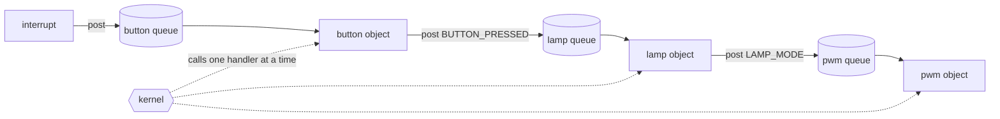

# active-objects

This skill makes a coding agent hold to the active-object pattern in
embedded C. It covers the objects and the kernel underneath them, whether
that kernel is a cooperative one written for the project or RTOS threads on
FreeRTOS or Zephyr.

The agent reads `SKILL.md` and, for each task, the matching module in
`references/`. This README and the guides in `guide/` are for people.

## The pattern

An **active object** is a module that owns its data and the hardware it
drives. It has its own queue of events and handles them one at a time,
finishing each before starting the next. A state machine keeps track of
where the object is. Other code never reaches inside the object. To make it
do something, you post an event to its queue and carry on.

Three properties hold the pattern together:

1. **One owner.** Each piece of data and each resource belongs to one
   object. Nobody else touches it, so objects need no locks between them.
2. **Queues only.** Objects communicate only by posting events. None calls
   into another or reads its variables. Each object can change inside
   without breaking the others, and the order of events shows what happened.
3. **Run to completion.** A handler deals with one event fully and returns
   without waiting. Nothing else touches the object's data while the handler
   runs, so its code can be read from top to bottom.

Together these remove data races and locks between objects. You can reason
about timing, test each object alone by feeding it events, and draw its
behaviour as a state machine. In return, the pattern forbids getters
between objects, waiting inside handlers, and long work in interrupts. It
also requires an agreed meaning and data for every message, and queues
sized so that they never fill.

### The parts

| Part | What it is |
|---|---|
| object | a module with private state, one handler, one queue and its own timers |
| event | a signal naming what happened, such as `DOOR_OPENED`, plus agreed data |
| signal | one value of a single project-wide `enum` |
| queue | the object's own first-in, first-out list of events |
| handler | the function that takes one event, reacts and returns |
| state machine | the object's behaviour, made of states, transitions, and entry and exit actions |
| timer | posts a "time is up" event into its own object's queue |
| kernel | the queues, the timers, and the dispatcher that calls handlers |

### Contracts and decisions

The skill sorts every design detail into contracts and decisions.

- A **contract** is intransitive. It belongs to the pattern itself and holds
  for every project, kernel and team. For example, a handler never blocks,
  and no object reads another's variables. The agent enforces contracts, and
  sets one aside only when you approve an exception for a stated reason.
- A **decision** is transitive. People make it for a particular project, and
  the next project may decide differently. Examples are the choice between
  cooperative scheduling and RTOS threads, the data an event carries, and
  what an error does in the product. The agent puts each decision to you
  with its options and default, and waits for your approval before any code
  relies on it.

`references/decisions.md` numbers the decisions D1 to D16.

### Kernels

The objects stay the same when the kernel changes.

- **A cooperative kernel written for the project** is the default. One loop
  calls the handlers one after another, by priority. Only interrupts can
  interrupt a handler. The kernel is
  small and predictable. Every handler must be short, because the longest
  one delays everything else.
- **RTOS threads** make each object a FreeRTOS or Zephyr thread that waits
  only on its own queue. A higher-priority object can preempt a lower one,
  so a long handler elsewhere cannot hold up urgent work. Each object still
  handles its own events one at a time. Because nothing is shared, the
  objects still need no locks.

`references/kernel.md` sets out what any kernel must do and the interface
the objects use. `guide/10-reference-kernel.md` shows a reference implementation in C and
the details for FreeRTOS and Zephyr.

## How the skill is organised

| File | What it holds | When the agent reads it |
|---|---|---|
| `SKILL.md` | a short router with the contract and decision rule, the three properties, what never to do, and which module to read for each task | always |
| `references/decisions.md` | how to put a decision to the user, and the decisions D1 to D16 with their options and defaults | when a project choice comes up |
| `references/objects-and-messages.md` | objects, events and signals, messages between objects, queues as the objects see them, ownership and sharing | when designing objects and their messages |
| `references/handlers.md` | run to completion, and code in interrupts, callbacks and other threads | when writing a handler or interrupt code |
| `references/state-machines.md` | the state-machine rules, the event table, state-handler functions in C, nested states, deferred events and common shapes | when designing or coding behaviour |
| `references/timers.md` | the timer rules and the options for late timeouts | when using timers |
| `references/kernel.md` | what every kernel must do, start-up and shutdown, the interface the objects use, the cooperative loop and its pitfalls, RTOS threads, and measuring handler time | before kernel work |
| `references/diagrams.md` | the rules for drawing each object as a UML statechart and the objects as a network in PlantUML, the notation and two examples | when drawing a diagram or checking one against the code |
| `references/review.md` | red flags and the conformance check | before finishing or reviewing any change |
| `README.md` | this explanation and the sources | never, because it is for people |
| `guide/01-active-objects.md` | why active objects: inversion of control, the older ways of managing the CPU, the active object model, the rules and heuristics | never, because it is for people |
| `guide/02-events-and-queues.md` | events and signals, direct posting and publish-subscribe, event memory, queue sizing, deferral | never, because it is for people |
| `guide/03-state-machines.md` | UML state machine concepts, with a map from the book's chapter 2 to the Crash Course note | never, because it is for people |
| `guide/04-coding-state-machines.md` | the standard ways of coding state machines, state-handler functions, nesting, pitfalls | never, because it is for people |
| `guide/05-state-patterns.md` | Ultimate Hook, Reminder, Deferred Event, Orthogonal Component, Transition to History | never, because it is for people |
| `guide/06-kernels.md` | the vanilla kernel, the preemptive run-to-completion kernel, a traditional RTOS, and how to choose | never, because it is for people |
| `guide/07-time.md` | time events, the clock tick, jitter, timeouts that were already posted | never, because it is for people |
| `guide/08-errors.md` | design by contract, errors and exceptional conditions, assertions in the product | never, because it is for people |
| `guide/09-designing-an-application.md` | the six design steps of the Dining Philosophers example, and devices owned by one object | never, because it is for people |
| `guide/10-reference-kernel.md` | a reference implementation of the kernel in C, its port and ring queue, and the details for FreeRTOS and Zephyr | never, because it is for people |
| `guide/glossary.md` | the terms of the guide, linked from their first use in each section | never, because it is for people |

The C sketches in `references/` and in `guide/10-reference-kernel.md` compile with
`gcc -std=c11 -Wall -Wextra -Wpedantic -Wconversion`, and the PlantUML
examples render with PlantUML 1.2020.02.

## Installing

Put the `active-objects` folder, with all its files, in your skills
directory, or upload it as a folder or zip wherever your Claude app lets you
add skills. The folder name must match the `name` in `SKILL.md`.

## Sources

The skill itself names no sources, so that it reads as a practical guide.
It draws on the following.

- Miro Samek, *Practical UML Statecharts in C/C++: Event-Driven Programming
  for Embedded Systems*, 2nd edition. Newnes/Elsevier, 2009.
  ISBN 978-0-7506-8706-5.
  - The active-object model: encapsulation, events in place of shared data,
    and run to completion.
  - Event delivery and memory: direct posting, publish-subscribe, and pooled
    read-only events.
  - Time events, and timeouts that were already posted.
  - Queue overflow as a design error, and sizing queues by measurement.
  - Handling errors by design by contract.
  - Start-up order, and an idle in a cooperative kernel that cannot miss an
    event.
  - Running active objects on a conventional RTOS.
  - Rules for coding state machines, and the recurring state shapes.
  - State handlers complete enough to draw the state from its code alone.
  - State-handler functions with entry and exit as reserved signals, and
    an event processor that runs a transition's action before its exit and
    entry actions.
- Miro Samek, "A Crash Course in UML State Machines", Quantum Leaps
  application note.
  <https://www.state-machine.com/doc/AN_Crash_Course_in_UML_State_Machines.pdf>
  - States versus flags, and the limits of guards.
  - Entry and exit actions, and internal versus self-transitions.
  - The order in which a transition runs, and nested states.
- "Active Objects (Actors)", excerpts from the book above, Quantum Leaps.
  <https://www.state-machine.com/doc/PSiCC2_Active-Objects.pdf>
- PlantUML, the state diagram and component diagram syntax.
  <https://plantuml.com/state-diagram>,
  <https://plantuml.com/component-diagram>
  - The notation of the statecharts and the network diagram.
- The earlier version of this skill, written for bare-metal embedded C.
  - The core rules on queues, handlers, interrupts and single ownership.
  - The per-message argument about full queues.
  - The red flags.
  - The mechanics of the cooperative kernel: the ring queue, posting that is
    safe from interrupts, an idle that cannot miss an event, and timers that
    stay correct across counter wrap-around.
