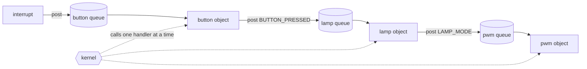

# active-objects

A skill that keeps a coding agent faithful to the active-object pattern in
embedded C. It covers the objects themselves and the kernel underneath
them, whether that is a cooperative kernel written for the project or RTOS
threads on FreeRTOS or Zephyr.

This README explains the pattern for people. The agent reads `SKILL.md`
and, when needed, the files in `references/`.

## The pattern

An **active object** is a module that owns its data and the hardware it
drives. It has its own queue of events and handles them one at a time,
start to finish, using a state machine to remember where it is. Other code
never reaches inside it. To make it do something, you post an event to its
queue and carry on.

Three promises make it work:

1. **One owner.** Each piece of data and each resource belongs to one
   object. Nobody else touches it, so objects need no locks between them.
2. **Queues only.** Objects talk only by posting events. None calls into
   another or reads its variables. Each can change inside without breaking
   the others, and the order of events shows what happened.
3. **Run to completion.** A handler deals with one event fully and returns
   without waiting. Nothing else touches the object's data while it runs,
   so its code reads top to bottom.

What you gain: no data races between objects and no locks, timing you can
reason about, objects you can test one at a time by feeding them events,
and behaviour you can draw as a state machine.

What it asks of you: no "quick" getters, no waiting inside handlers, no
work in interrupts beyond capturing data and posting, and an agreed
meaning, data and full-queue behaviour for every message.

### The parts

| Part | What it is |
|---|---|
| object | a module with private state, one handler, one queue and its own timers |
| event | a signal naming what happened, such as `DOOR_OPENED`, plus agreed data |
| signal | one value of a single project-wide `enum` |
| queue | the object's own first-in, first-out list of events |
| handler | the function that takes one event, reacts and returns |
| state machine | the object's behaviour: states, transitions, entry and exit actions |
| timer | posts a "time is up" event into its own object's queue |
| kernel | the queues, the timers, and the dispatcher that calls handlers |

### Contracts and decisions

The skill sorts every design detail into one of two kinds.

- A **contract** is intransitive. It belongs to the pattern itself and holds
  whatever project, kernel or team is involved. For example, a handler never
  blocks, and no object reads another's variables. The agent enforces
  contracts and sets one aside only when you approve an exception for a
  stated reason.
- A **decision** is transitive. It is a choice people make for a project, and
  can be made differently next time. For example, cooperative or RTOS
  threads, how much data an event carries, and what a full queue does. The
  agent puts each decision to you with its options and default, and waits
  for your approval before code relies on it.

The decisions are numbered D1–D15 in `references/decisions.md`.

### Two kernels, one pattern

The objects do not change when the kernel does.

- **A cooperative kernel written for the project** (the default). One loop
  calls handlers one after another, by priority. A handler is never
  interrupted by another handler, only by interrupts. It is small and
  predictable. Every handler must be short, because the longest one delays
  everything else.
- **RTOS threads.** Each object is a FreeRTOS or Zephyr thread that waits
  only on its own queue. A higher-priority object can preempt a lower one,
  so urgent work is not held up by a long handler elsewhere. Each object
  still handles its own events one at a time. Because nothing is shared,
  objects still need no locks.

`references/kernel.md` describes what any kernel must do, gives a C
interface sketch, and covers both forms.

## How the skill is organised

| File | What it holds | When the agent reads it |
|---|---|---|
| `SKILL.md` | a short router: how to treat contracts and decisions, the three promises, what never to do, and which module to read for which task | always |
| `references/decisions.md` | how to put a decision to the user, and the decisions D1–D15 with options and defaults | when a project choice comes up |
| `references/objects-and-messages.md` | objects, events and signals, messages between objects, queues from the objects' side, ownership and sharing | when designing objects and their messages |
| `references/handlers.md` | run to completion; interrupts, callbacks and other threads | when writing a handler or interrupt code |
| `references/state-machines.md` | state-machine contracts and words, the event table, a flat machine in C, nested machines, deferring events, useful shapes, a checklist | when designing or coding behaviour |
| `references/timers.md` | timer contracts and the options for late timeouts | when using timers |
| `references/kernel.md` | what every kernel must do, start-up and shutdown, the C interface with project-defined types, the cooperative kernel and its port layer, RTOS threads on FreeRTOS and Zephyr, a kernel checklist | before kernel work |
| `references/review.md` | warning signs and the conformance check | before finishing or reviewing any change |
| `README.md` | this explanation and the sources | never; it is for people |

The C sketches in the references compile with
`gcc -std=c11 -Wall -Wextra -Wpedantic -Wconversion`.

## Installing

Put the `active-objects` folder, with all its files, in your skills
directory, or upload it as a folder or zip where your Claude app lets you
add skills. The folder name must match the `name` in `SKILL.md`.

## Sources

The skill draws on these. They are acknowledged here rather than inside the
skill, so that the skill stays a practical guide.

- Miro Samek, *Practical UML Statecharts in C/C++: Event-Driven Programming
  for Embedded Systems*, 2nd edition. Newnes/Elsevier, 2009.
  ISBN 978-0-7506-8706-5.
  - The active-object model: encapsulation, events instead of shared data,
    and run to completion.
  - Event delivery and memory: direct posting and publish-subscribe, and
    pooled read-only events.
  - Time events and timeouts that were already posted.
  - Queue overflow as a design error, and sizing queues by measurement.
  - Errors handled by design by contract.
  - Start-up order, and a race-free idle in a cooperative kernel.
  - Running active objects on a conventional RTOS.
  - State-machine coding rules and the recurring state shapes.
- Miro Samek, "A Crash Course in UML State Machines", Quantum Leaps
  application note.
  <https://www.state-machine.com/doc/AN_Crash_Course_in_UML_State_Machines.pdf>
  - States versus flags, and the limits of guards.
  - Entry and exit actions, and internal versus self-transitions.
  - The order in which a transition runs, and nested states.
- "Active Objects (Actors)", excerpts from the book above, Quantum Leaps.
  <https://www.state-machine.com/doc/PSiCC2_Active-Objects.pdf>
- The earlier version of this skill, written for bare-metal embedded C.
  - The core rules on queues, handlers, interrupts and single ownership.
  - The per-message argument about full queues.
  - The warning signs.
  - The cooperative kernel's mechanics: the ring queue, posting that is safe
    from interrupts, an idle that cannot miss an event, and timers that are
    safe across counter wrap-around.
