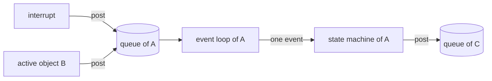

# 1. Active objects

Samek builds his approach to embedded software on one idea: the program is a set of [active objects](glossary.md#active-object) that react to events. The idea answers problems that older ways of structuring embedded code share. The book develops it in chapter 6 (sections 6.1 to 6.3) and sums it up as rules in chapter 9 (section 9.1).

## Events control the program

A sequential program waits for the input it needs at the place where it needs it. While it waits for one kind of event, it cannot respond to any other. An event-driven program works the other way round. It follows the Hollywood principle, ‘Don’t call us, we’ll call you.’ The program is called when an event arrives, handles the event and quickly returns control (section 6.1).

Control therefore sits in the infrastructure that delivers the events. Samek calls this *[inversion of control](glossary.md#inversion-of-control)* and takes from Ralph Johnson and Brian Foote the point that inversion of control is what makes a framework. A toolkit, such as a traditional real-time operating system (RTOS), is a set of functions that your main program calls. A framework is the main program, and it calls your code. Event-driven infrastructures tend to become frameworks because ‘the events are controlling the application, not the other way around’ (section 6.1).

## Three older ways to manage the CPU

Section 6.2 compares three traditional structures before introducing [active objects](glossary.md#active-object). Each fails in its own way.

| Structure | How it waits for events | What goes wrong |
|---|---|---|
| Sequential program, the *superloop* or *foreground/background* system | It polls for input inside the functions of one endless loop, while interrupts handle the hardware. | ‘a sequential system is unresponsive while waiting, which is actually most of the time’. Polling is scattered through the code, so new events are hard to add. |
| Traditional multitasking | Each task is an endless loop that blocks on semaphores, mailboxes or queues. A kernel switches between tasks, each with its own stack. | ‘A blocked task waiting for an event is unresponsive to all other events.’ A preemptive kernel can switch tasks at almost any instruction, so shared data needs mutexes, and programmers ‘vastly underestimate the risks and skills needed to use these mechanisms safely’. |
| Traditional event-driven system | One event loop takes events from one queue and calls an event-handler function for each event type. | All events wait in one queue, so urgent work cannot overtake. The handlers react to the event type alone and keep the context in flags. Every handler reads and writes the same global data. |

The event-driven system already has the property that matters most. Its dispatcher calls the next handler only after the previous one has returned, so every handler finishes its work before another starts. The queue exists because of that: it keeps the events that arrive while a handler is busy (section 6.2.3). The active object model keeps this property and repairs the three weaknesses.

## The active object computing model

The term *[active object](glossary.md#active-object)* comes from the UML, where it means ‘an object having its own thread of control’. Samek traces the concept to the *actors* of Carl Hewitt in the 1970s and to the ROOM method of the 1990s (sidebar in section 6.3). The essential idea is ‘to use multiple event-driven systems in a multitasking environment’. Each active object combines three parts:

- a thread of control, which is an event loop of its own
- a private event queue
- a state machine, which decides how the object reacts

The event loop waits until the queue holds an event, takes it out and gives it to the state machine, which handles it completely and returns. Then the loop waits again.

### Asynchronous communication

Active objects receive events only through their queues. A producer posts an event and carries on without waiting for it to be handled (section 6.3.2). ‘The system makes no distinction between external events generated from interrupts and internal events originating from active objects.’ An active object may also post to itself.

### Run to completion

Each active object handles one event fully before it takes the next (section 6.3.3). The handling of one event is called a *[run-to-completion](glossary.md#run-to-completion) step*, or *RTC step*. Events that arrive in the meantime wait in the queue. A state machine therefore never meets a new event in the middle of a transition, which removes all concurrency problems inside one object (section 2.2.8).

Run to completion concerns one object only. Under a preemptive kernel another thread may interrupt an RTC step, and the step continues later from where it stopped. ‘RTC does not mean that the active object thread has to monopolize the CPU until the RTC step is complete.’ Preemption stays harmless as long as the objects share nothing.

The price of run to completion is responsiveness. In Samek's words, ‘the responsiveness of a state machine is determined by its longest RTC step’ (section 2.2.8). Long processing has to be cut into short steps, which chapter 5's [Reminder](glossary.md#reminder) pattern does (see [State patterns](05-state-patterns.md)).

### Encapsulation

Active objects share no data and no other resources (section 6.3.4). Their only link to each other and to the outside world is the asynchronous exchange of events, which the framework makes thread-safe. Because nothing is shared, objects can preempt one another without corrupting memory, and application programmers never need semaphores or mutexes. Samek quotes Jack Ganssle's advice for tasks, which applies here exactly: ‘Keep all of the task’s data local, bound to the code itself and hidden from the rest of the system.’

### State machines hold the context

Event-driven code has a known weakness. A sequential program keeps its progress in the program counter and in local variables on the stack. An event handler loses both when it returns, so the expected order of events disappears into separate handler functions and static variables (section 6.3.5). State machines fill that gap: ‘State machines are exactly designed to represent the execution context (state and [extended-state variables](glossary.md#extended-state-variable)) in static data.’ The state shows again which events the object expects next.

The active object's event loop also has no generic dispatcher that maps events to handlers. How an event is handled depends on the object's current state, so the state machine itself does the dispatching (section 6.3.5).

## Framework, kernel and application

Everything generic belongs to the framework: the queues, the event loops and the [event processor](glossary.md#event-processor) that executes the state machines (section 6.3.1). The application consists of the specific state machines, which the framework calls. The framework in turn sits on a kernel or an RTOS. Applications use only the framework's interface and never the RTOS's directly, so the framework also hides the RTOS. Changing the RTOS means porting the framework, and the application stays as it is.

## The rules and the heuristics

Section 9.1.1 states two rules and asks for them to be followed ‘without exception’:

1. ‘Active objects should interact only through an asynchronous event exchange and should not share memory or other resources’.
2. ‘Active objects should not block or busy-wait for events in the middle of RTC processing.’

In return the framework can guarantee freedom from race conditions, deadlocks, priority inversions, starvation and nondeterminism, and the application needs no mutexes or semaphores at all. Samek expects programmers to be tempted to share a variable or block a thread now and then, and he proposes to ‘treat every temptation to break the rules as an opportunity to discover something important about your application’. A shared variable often hides a missing signal or [event parameter](glossary.md#event-parameter).

The heuristics of section 9.1.2 follow from the same model:

- Partition the problem for loose coupling: avoid shared resources and keep the number and size of the exchanged events small.
- Give each shared resource to one [active object](glossary.md#active-object) that manages it for the rest of the system.
- An object's responsiveness is its longest RTC step. To meet hard deadlines, break long processing into shorter steps or hand it to a lower-priority object.
- Start the design with sequence diagrams of the main use cases. They reveal the signals and event parameters, which in turn shape the objects.
- Build an executable model early, even a nearly empty one, possibly on a PC first.
- Most of the work is in the state machines of the active objects. The threads and queues can mostly be ignored once the framework is in place.

## In the skill

The skill's three properties are this model in short form: *one owner* is encapsulation, *queues only* is asynchronous communication, and *[run to completion](glossary.md#run-to-completion)* is the RTC step. Its list of things never to do starts with the two rules of section 9.1.1 (`SKILL.md`).
