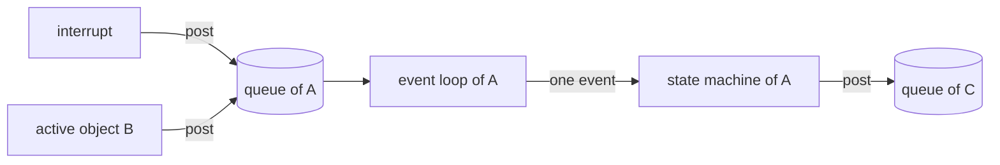

# 1. Active objects

An [active object](glossary.md#active-object) is a piece of software that owns its data, receives work only as events in its own queue, and decides how to react with a state machine. A program built from active objects avoids the problems that the older ways of structuring embedded software share.

## Events control the program

A sequential program waits for the input it needs at the place where it needs it, and while it waits for one kind of event it cannot respond to any other. An event-driven program follows the Hollywood principle, ‘Don’t call us, we’ll call you.’ It is called when an event arrives, handles the event and quickly returns control.[^1]

Control therefore sits in the infrastructure that delivers the events. This *[inversion of control](glossary.md#inversion-of-control)* is what distinguishes a framework from a toolkit.[^2] A toolkit, such as a traditional real-time operating system (RTOS), is a set of functions that the application calls. A framework is the main body of the program, and it calls the application's code. Event-driven infrastructures take the form of frameworks because the events control the application.

## Three older ways to manage the CPU

| Structure | How it waits for events | What goes wrong |
|---|---|---|
| Sequential program, the *superloop* or *foreground/background* system | It polls for input inside the functions of one endless loop, while interrupts handle the hardware. | It cannot respond while it waits, which is most of the time, and the polling scattered through the code makes new events hard to add.[^3] |
| Traditional multitasking | Each task is an endless loop that blocks on semaphores, mailboxes or queues, and a kernel switches between the tasks, each with its own stack. | A blocked task cannot respond to any other event. A preemptive kernel can switch tasks at almost any instruction, so shared data needs mutexes, whose risks are widely underestimated.[^4] |
| Traditional event-driven system | One event loop takes events from one queue and calls an event-handler function for each event type. | All events wait in one queue, so urgent work cannot overtake. The handlers react to the event type alone and track the context in flags, and all of them share the same global data.[^5] |

The event-driven system already has the property that matters most: its dispatcher calls the next handler only after the previous one has returned, so every handler finishes before another starts. The queue exists because of that property. It keeps the events that arrive while a handler is busy.[^6] The [active object](glossary.md#active-object) model keeps the property and repairs the three weaknesses.

## The active object computing model

The UML defines an [active object](glossary.md#active-object) as ‘an object having its own thread of control’. The concept goes back to the *actors* of Carl Hewitt in the 1970s and to the ROOM method of the 1990s. Its essential idea is to run several event-driven systems in a multitasking environment. Each active object combines three parts:[^7]

- a thread of control, which is an event loop of its own
- a private event queue
- a state machine, which decides how the object reacts

The event loop waits until the queue holds an event, takes it out and passes it to the state machine, which handles it completely and returns. Then the loop waits again.

### Asynchronous communication

Active objects receive events only through their queues. A producer posts an event and carries on without waiting for it to be handled. Events from interrupts and events from other active objects are treated alike, and an active object may also post to itself.

### Run to completion

Each active object handles one event fully before it takes the next. The handling of one event is a *[run-to-completion](glossary.md#run-to-completion) step*, or *RTC step*, and events that arrive in the meantime wait in the queue. A state machine therefore never meets a new event in the middle of a transition, which removes every concurrency problem inside one object.

Run to completion concerns one object only. Under a preemptive kernel another thread may interrupt an RTC step, which later continues where it stopped, and the preemption stays harmless as long as the objects share nothing.[^8]

The price is responsiveness: an object cannot respond faster than its longest RTC step.[^9] Long processing has to be cut into short steps, which the [Reminder](glossary.md#reminder) pattern does (see [State patterns](05-state-patterns.md)).

### Encapsulation

Active objects share no data and no other resources, and their only link to each other and to the outside world is the asynchronous exchange of events, which the framework makes thread-safe. Because nothing is shared, objects can preempt one another without corrupting memory, and the application needs no semaphores or mutexes. Jack Ganssle's advice for RTOS tasks applies directly: ‘Keep all of the task’s data local, bound to the code itself and hidden from the rest of the system.’[^10]

### State machines hold the context

A sequential program keeps its progress in the program counter and in local variables on the stack. An event handler loses both when it returns, so the expected order of events disappears into separate handler functions and static variables. A state machine keeps the execution context, its state and its [extended state variables](glossary.md#extended-state-variable), in static data, and its states make the expected order of events visible again.[^11]

The event loop of an active object has no generic dispatcher that maps events to handlers. How an event is handled depends on the object's current state, so the state machine does the dispatching.

## Framework, kernel and application

Everything generic belongs to the framework: the queues, the event loops and the [event processor](glossary.md#event-processor) that executes the state machines. The application consists of the specific state machines, which the framework calls. The framework sits on a kernel or an RTOS, and the application uses only the framework's interface. Changing the RTOS then means porting the framework, while the application stays as it is.

## Rules and heuristics

Two rules hold without exception:[^12]

1. ‘Active objects should interact only through an asynchronous event exchange and should not share memory or other resources’.
2. ‘Active objects should not block or busy-wait for events in the middle of RTC processing.’

A program that keeps both rules is free from race conditions, deadlocks, priority inversions, starvation and nondeterminism, and it needs no mutexes or semaphores at the application level.[^13] A temptation to break the rules usually points to something missing in the design, often a signal or an [event parameter](glossary.md#event-parameter) in place of a shared variable.

The heuristics follow from the same model:

- Partition the problem for loose coupling, with no shared resources and as few and as small events as possible.
- Give each shared resource to one [active object](glossary.md#active-object) that manages it for the rest of the system.
- An object responds no faster than its longest RTC step. To meet hard deadlines, break long processing into shorter steps or hand it to a lower-priority object.
- Start the design with sequence diagrams of the main use cases, which reveal the signals and event parameters and so shape the objects.
- Build an executable model early, even a nearly empty one, possibly on a PC first.
- Spend most of the effort on the state machines. Threads and queues can mostly be ignored once the framework is in place.

## In the skill

The skill's three properties are this model in short form: *one owner* is encapsulation, *queues only* is asynchronous communication, and *[run to completion](glossary.md#run-to-completion)* is the RTC step. Its list of things never to do starts with the two rules (`SKILL.md`).

[^1]: Miro Samek, *Practical UML Statecharts in C/C++: Event-Driven Programming for Embedded Systems*, 2nd ed. (Newnes, 2009), §6.1, p. 256.
[^2]: Ibid.
[^3]: Ibid., §6.2.1, p. 258.
[^4]: Ibid., §6.2.2, p. 263.
[^5]: Ibid., §6.2.3, p. 265.
[^6]: Ibid., §6.2.3, p. 264.
[^7]: Ibid., §6.3, p. 266.
[^8]: Ibid., §6.3.3, p. 269.
[^9]: Ibid., §2.2.8, p. 68.
[^10]: Ibid., §6.3.4, p. 270.
[^11]: Ibid., §6.3.5, p. 272.
[^12]: Ibid., §9.1.1, p. 444.
[^13]: Ibid.
