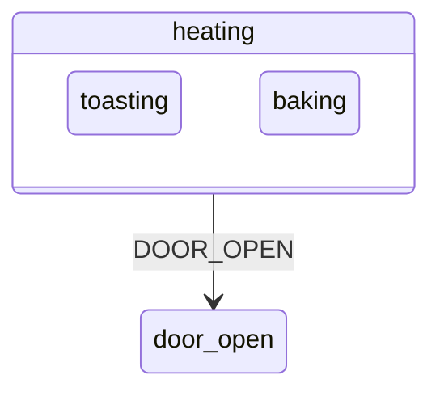

# 3. State machines

Every [active object](glossary.md#active-object) decides its reactions with a state machine. UML state machines extend the classical [finite state machine](glossary.md#finite-state-machine) with nesting, entry and [exit actions](glossary.md#exit-action) and a defined order of execution.

## The event alone does not decide the reaction

A calculator program that shipped with Microsoft Visual Basic crashes on the keys 2, minus, minus, minus, 2, equals, because the minus key means negation in one context and subtraction in another. Its code tracks the context in global flags such as `DecimalFlag`, `OpFlag`, `LastInput` and `NumOps`, so no single variable says which mode the program is in. Every handler has to evaluate tangled conditions over those flags, and switching modes means changing several variables consistently.

An event alone does not determine the actions to execute in response. The current context matters as much. The usual *event-action paradigm* maps each kind of event to one piece of code and leaves the context to ad hoc flags, which grow into spaghetti code.[^1]

## States

Most event-driven behaviour falls into a small number of chunks. Within one chunk, the response to an event depends only on the event and no longer on the history that led there. A *[finite state machine](glossary.md#finite-state-machine)* calls these chunks *states*, and a change from one to another a *state transition*.[^2]

A state captures the relevant part of the system's history. A keyboard sends upper-case or lower-case codes depending on one fact of its history, whether Caps Lock was pressed, so its behaviour falls into two states, *default* and *caps_locked*.[^3] In code, one *state variable* replaces the many flags: testing it identifies the context, and assigning it changes the context in one step.

A state diagram draws states as rounded boxes and transitions as arrows labelled with the triggering event and the actions. An *[initial transition](glossary.md#initial-transition)* from a solid dot marks the starting state.

### A state is not a step in a flowchart

A flowchart passes from node to node by itself as each activity completes, and it is busy while it sits in a node. A state machine sits idle in a state and changes state only when an event triggers a transition. A flowchart describes the progress of a task from beginning to end, like an assembly line, while a keyboard in *caps_locked* is no further along than one in *default*. A state specifies a behaviour, not a stage of processing.[^4] The two diagrams stand for opposed styles of programming: event-driven programming with state machines, and transformational programming with flowcharts.

## Extended state and guards

A keyboard that breaks after 1,000 keystrokes would need 1,000 states. *Extended state machines* add variables, so the full condition of the system, its *extended state*, combines a qualitative part, the state, with quantitative parts, the *[extended state variables](glossary.md#extended-state-variable)*, such as a keystroke counter.[^5]

Variables bring *[guards](glossary.md#guard)*: Boolean conditions on variables and [event parameters](glossary.md#event-parameter) that enable or disable a transition. In code, guards are the same `if` and `else` that state machines were meant to remove, and their abuse is the main way in which designs based on state machines decay.[^6] A calculator that remembers a decimal point in a flag does better with a distinct state, *entering the fractional part of a number*, in which further decimal points are ignored. The state keeps the context only as long as it matters and forgets it on leaving, whereas a flag lingers and has to be reset. States are fixed at compile time and suit facts known in advance. A count with a wide range belongs in a variable.

A state may have several transitions on the same event, provided their guards never overlap. UML leaves the order of guard evaluation open, so guards must have no side effects that change other guards.[^7]

## Run to completion

A state machine finishes processing one event before it starts the next. Each event is processed in one indivisible *RTC step*, and new events wait in a queue. While an action executes, the machine is between two states, but nothing outside can observe it in that moment. [Active objects](01-active-objects.md) covers what [run to completion](glossary.md#run-to-completion) means for a whole system.

## States inside states

Flat state machines suffer from *state explosion*: their complexity grows much faster than the complexity of the behaviour they describe, because they cannot share behaviour between states. A calculator handles its Clear key identically in almost every state, and a flat machine repeats that transition in each of them. David Harel's *statecharts* solve this with *hierarchically nested states*, and UML state machines are object-based variants of them.

The idea comes from graphical user interfaces. Every event goes first to the application, and whatever the application does not handle flows back to the system, which applies the standard look and feel. The application codes only its differences from the standard behaviour. Charles Petzold called this pattern the *[Ultimate Hook](glossary.md#ultimate-hook)*.

Nested states apply the same rule. A system in the [substate](glossary.md#substate) *s11* is also in its [superstate](glossary.md#superstate) *s1*. An event goes to *s11* first, and if *s11* does not handle it, *s1* does, and so on outwards.[^8] In a toaster oven, the states *toasting* and *baking* sit inside *heating*, and a single transition on DOOR_OPEN from *heating* to *door_open* serves both.

A state that contains other states is a *[composite state](glossary.md#composite-state)*, and a state with no inner states is a *simple* or *[leaf state](glossary.md#leaf-state)*. Every UML state machine has an implicit *[top state](glossary.md#top-state)* that contains all the others.

### Behavioural inheritance

Nesting works like inheritance. Class inheritance says *is a*: a bird is an animal. State nesting says *is in*: an oven that is toasting is in the heating state, and everything that holds for heating, such as a heater that is on, holds for toasting. A substate is defined by its differences from its superstate, which is called *[behavioural inheritance](glossary.md#behavioural-inheritance)*.[^9]

A substate must stay consistent with its superstate, which is the Liskov Substitution Principle applied to states. If being in *heating* means that the heater is on, no state inside *heating* may turn the heater off without leaving *heating*. Only then can a designer reason at the level of the superstate and ignore the details inside.[^10]

### Orthogonal regions

Nesting is an *OR* decomposition: an oven in *heating* is in *toasting* or in *baking*. A composite state can also contain *[orthogonal regions](glossary.md#orthogonal-region)*, all active at once, which is an *AND* decomposition.[^11] A keyboard's main keypad (*default* or *caps_locked*) and its numeric keypad (*numbers* or *arrows*) are independent. Combined in one flat machine they need four states, the product of the two, while two regions need two plus two. Real regions are seldom fully independent and coordinate by sending events to each other. No design may depend on the order in which an event reaches the regions.

## Entry and exit actions

Every state may have *[entry actions](glossary.md#entry-action)*, which run whenever the state is entered, and *[exit actions](glossary.md#exit-action)*, which run whenever it is left, regardless of the transition. They guarantee initialisation and cleanup, much as constructors and destructors do for objects.[^12] A toaster's *heating* state switches the heater on in its entry action and off in its exit action, so no transition can leave the heater on by mistake. Its *door_open* state switches the oven lamp on at entry and off at exit. A timer is armed on entry to a state and disarmed on exit in the same way.

Entry and exit actions keep the meaning of a state safe from later changes to its transitions, so they are preferred to actions on transitions.[^13]

## Internal transitions and self-transitions

An event can cause actions without a change of state, as each keystroke does on a keyboard. Such a reaction is an *[internal transition](glossary.md#internal-transition)*, and it executes only its own actions. A *[self-transition](glossary.md#self-transition)* leaves the state and enters it again, so its exit and [entry actions](glossary.md#entry-action) run.

## The order of a transition

In a nested machine several states are active at once, so a transition has to say which states it leaves and which it enters. It exits the active states up to, but not including, the *[least common ancestor](glossary.md#least-common-ancestor)* (LCA) of its source and its target. It then enters states from the LCA down to the target. If the target is a [composite state](glossary.md#composite-state), its [initial transitions](glossary.md#initial-transition) lead further down until a [leaf state](glossary.md#leaf-state) is reached.[^14]

UML prescribes this sequence:[^15]

1. Evaluate the [guard](glossary.md#guard), and continue only if it is true.
2. Exit the source [state configuration](glossary.md#state-configuration).
3. Execute the transition's actions.
4. Enter the target state configuration.

The QEP [event processor](glossary.md#event-processor) executes the transition's actions before the exits, in the context of the source state, where the guard was evaluated.[^16] The UML order runs the actions after the source has been taken apart and before the target exists, which resembles calling a method on a half-destroyed object. In QEP's order, the machine can be observed only in a stable configuration, before or after the transition.

For a transition *T1* from state *s11*, inside *s1*, to state *s21*, inside *s2*, with guard *g()* and action *t()*, the two orders compare as follows:

| | Order of calls |
|---|---|
| UML | g(), then the exits a() and b(), then t(), then the entries c(), d() and e() |
| QEP | g(), then t(), then a() and b(), then c(), d() and e() |

## Local and external transitions

A transition between a state and one of its own [substates](glossary.md#substate) can be read in two ways. An *external* transition leaves the outer state and enters it again, and a *local* transition stays inside it. UML 2 allows both, and QEP implements only [local transitions](glossary.md#local-transition).[^17]

## Every transition topology in one machine

A test machine with six states (*s*, *s1*, *s11*, *s2*, *s21* and *s211*) and nine events, A to I, contains every kind of transition up to four levels of nesting. Every action prints its name, so each event shows the exact order of exits, actions and entries.[^18] Its runs show the rules one by one:

- An event that the active state does not handle goes to the next state up, and the state that handles it executes the transition's action before the exits.
- An inherited [internal transition](glossary.md#internal-transition) never changes the state.
- An inherited [self-transition](glossary.md#self-transition) exits and re-enters the state that defines it.
- A [guard](glossary.md#guard) that evaluates to false disables its transition, as if the state did not define it, so the event goes to the [superstate](glossary.md#superstate). A guard on an internal transition works the same way.
- A transition whose target's [initial transition](glossary.md#initial-transition) skips a level still executes the [entry action](glossary.md#entry-action) of the skipped state.
- One inherited transition produces different exits depending on the state that is active when the event arrives.

## Event types, deferral and pseudostates

UML knows four kinds of event: a *signal event*, a *[time event](glossary.md#time-event)* (the keyword *after*), a *call event* and a *change event* (the keyword *when*). QEP supports only signal events, and the QF framework adds time events that the program arms and disarms explicitly.[^19]

A UML state can list events that it *defers*. They are kept and recalled automatically once a state is entered that does not defer them. QEP implements deferral as an explicit pattern instead (see [Events and queues](02-events-and-queues.md)).

*[Pseudostates](glossary.md#pseudostate)* are transient nodes of the diagram:[^20]

| Pseudostate | Purpose |
|---|---|
| initial | the source of an [initial transition](glossary.md#initial-transition), which may have actions but no trigger or [guard](glossary.md#guard) |
| choice | a branch whose outgoing path depends on the results of actions taken earlier in the same RTC step |
| shallow history | the most recent active direct [substate](glossary.md#substate) of a [composite state](glossary.md#composite-state) |
| deep history | the whole most recent [state configuration](glossary.md#state-configuration) inside a composite state |
| junction | a vertex that merges transitions or splits one transition into guarded segments, all guards evaluated before the transition |
| join and fork | the merging of transitions from several [orthogonal regions](glossary.md#orthogonal-region), and the splitting of one transition into several regions |

## What the diagrams cannot show

The concept of a [hierarchical state machine](glossary.md#hierarchical-state-machine) does not depend on any notation. Diagrams show the order of processing poorly, such as the order of [guard](glossary.md#guard) evaluation or of dispatch to [orthogonal regions](glossary.md#orthogonal-region). Joins, forks, junctions and choice points are the old flowchart in disguise, and plain structured code expresses that flow of control just as well.[^21] A full state machine is the diagram together with its textual actions and guards.

## Designing a state machine

A state machine is designed in iterations: design a little, code a little, test a little. A correct calculator comes out of five steps that carry over to other designs:

1. **Primary use case first.** The first machine handles only *operand1*, *opEntered*, *operand2* and the result, and a *result* state keeps the result on the display.
2. **Simplify the signals.** The four operator keys become one OPER signal before they reach the machine.
3. **Scavenge for reuse.** Cancel and Off must work at any time, so their transitions are defined once, in a [superstate](glossary.md#superstate) *on*, from which every [substate](glossary.md#substate) inherits them.[^22]
4. **Elaborate [composite states](glossary.md#composite-state).** Each operand state gets a submachine with *zero*, *int* and *frac* substates. *zero* ignores further zeros and *frac* ignores further decimal points, each through an [internal transition](glossary.md#internal-transition) with no actions.
5. **Refine the behaviour.** The minus key means negation in two contexts only, at the start of a computation and after an operator. Two new states, *negated1* and *negated2*, and a *begin* state for the start of a computation capture those contexts.

More than one correct design satisfies a specification.

## In the skill

`references/state-machines.md` turns these concepts into rules: states in place of flags, [guards](glossary.md#guard) without side effects, entry and [exit actions](glossary.md#exit-action) for set-up and clean-up, no change of state inside them, [initial transitions](glossary.md#initial-transition), and nesting where it removes repetition. Its transition order is QEP's: the action, then the exits, then the entries. Decision D10 defaults to [local transitions](glossary.md#local-transition). `references/diagrams.md` sets how the machines are drawn.

[^1]: Miro Samek, *Practical UML Statecharts in C/C++: Event-Driven Programming for Embedded Systems*, 2nd ed. (Newnes, 2009), §2.1, p. 59.
[^2]: Ibid., §2.2, p. 59.
[^3]: Ibid., §2.2.1, p. 60.
[^4]: Ibid., §2.2.3, p. 62.
[^5]: Ibid., §2.2.4, p. 63.
[^6]: Ibid., §2.2.5, p. 65.
[^7]: Ibid., §2.2.7, p. 67.
[^8]: Ibid., §2.3.2, p. 70.
[^9]: Ibid., §2.3.3, p. 72.
[^10]: Ibid., §2.3.4, p. 73.
[^11]: Ibid., §2.3.5, p. 74.
[^12]: Ibid., §2.3.6, p. 76.
[^13]: Ibid., §9.2.4, p. 452.
[^14]: Ibid., §2.3.8, p. 80.
[^15]: Ibid., §2.3.8, p. 79.
[^16]: Ibid., §2.3.8, p. 80.
[^17]: Ibid., §2.3.9, p. 81.
[^18]: Ibid., §2.3.15, p. 87.
[^19]: Ibid., §2.3.10, p. 82.
[^20]: Ibid., §2.3.12, p. 84.
[^21]: Ibid., §2.3.14, p. 86.
[^22]: Ibid., §2.4.3, p. 93.
