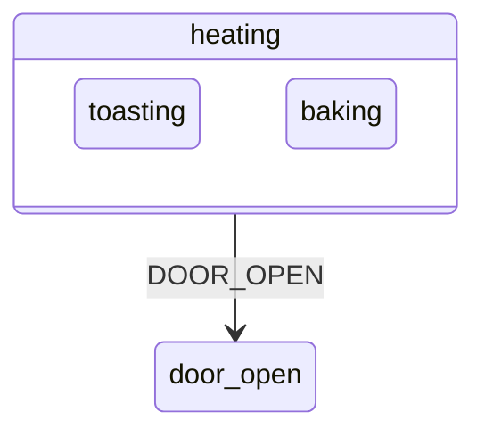

# 3. State machines

Every [active object](glossary.md#active-object) decides its reactions with a state machine. Chapter 2 of the book is a short course in UML state machines: why they are needed, the basic concepts, the UML extensions to them, and one design worked through from the start. Samek also publishes the chapter as a free application note, *A Crash Course in UML State Machines* (Quantum Leaps, 2015), with the same text under different section numbers:

| Topic | Book | Note |
|---|---|---|
| The event-action paradigm | 2.1 | 1.1 |
| States, extended state, [guards](glossary.md#guard), events, [run to completion](glossary.md#run-to-completion) | 2.2 | 1.2 |
| Nesting, [behavioural inheritance](glossary.md#behavioural-inheritance), the Liskov principle | 2.3.1 to 2.3.4 | 2.1 |
| [Orthogonal regions](glossary.md#orthogonal-region) | 2.3.5 | 2.2 |
| Entry and [exit actions](glossary.md#exit-action) | 2.3.6 | 2.3 |
| [Internal transitions](glossary.md#internal-transition) | 2.3.7 | 2.4 |
| The order of a transition | 2.3.8 | 2.5 |
| Local and [external transitions](glossary.md#external-transition) | 2.3.9 | 2.6 |
| Event types | 2.3.10 | none |
| Event deferral | 2.3.11 | 2.7 |
| [Pseudostates](glossary.md#pseudostate) | 2.3.12 | none |
| Code synthesis and the limits of diagrams | 2.3.13 and 2.3.14 | 2.8 and 2.9 |
| Every transition topology in one machine | 2.3.15 | 2.10 |
| Designing the calculator | 2.4 | 3 |

The section numbers below are the book's.

## The event alone does not decide the reaction

Section 2.1 dissects a calculator program that shipped with Microsoft Visual Basic, following an analysis by Ian Horrocks. The calculator crashes on the keys 2, minus, minus, minus, 2, equals, because the minus key means negation in one context and subtraction in another. Its code tracks the context in global flags such as `DecimalFlag`, `OpFlag`, `LastInput` and `NumOps`, so no single variable says which mode the program is in. Every handler has to evaluate tangled conditions over those flags, and switching modes means changing several variables consistently.

Samek's conclusion is that ‘an event alone does not determine the actions to be executed in response to that event’. The current context matters as much. The usual *event-action paradigm* maps each kind of event to one piece of code and leaves the context to ad hoc flags, which grow into what programmers call spaghetti code.

## States

Most event-driven behaviour falls into a small number of chunks. Within one chunk, the response to an event depends only on the event, no longer on the history that led there (section 2.2). A *[finite state machine](glossary.md#finite-state-machine)* calls these chunks *states*, and a change from one to another a *state transition*.

‘A state captures the relevant aspects of the system’s history very efficiently’ (section 2.2.1). A keyboard sends upper-case or lower-case codes depending on one fact of its history, whether Caps Lock was pressed, and on nothing else. Its behaviour therefore falls into two states, *default* and *caps_locked*. In code, one *state variable* replaces the many flags: testing it identifies the context, and assigning it changes the context in one step.

A state diagram draws states as rounded boxes and transitions as arrows labelled with the triggering event and the actions. An *[initial transition](glossary.md#initial-transition)* from a solid dot marks the starting state (section 2.2.2).

### A state is not a step in a flowchart

State diagrams and flowcharts look alike and mean opposite things (section 2.2.3). A flowchart passes from node to node by itself as each activity completes, and it is busy while it sits in a node. A state machine sits idle in a state and changes state only when an event triggers a transition. A flowchart describes the progress of a task from beginning to end, like an assembly line. A keyboard in *caps_locked* is not further along than one in *default*, it just reacts differently. ‘A state in a state machine is an efficient way of specifying a particular behavior, rather than a stage of processing.’ The two diagrams stand for two opposed styles of programming: event-driven (state machines) and transformational (flowcharts).

## Extended state and guards

A state cannot hold everything. A keyboard that breaks after 1,000 keystrokes would need 1,000 states. *Extended state machines* add variables, so the full condition of the system, the *extended state*, combines a qualitative part (the state) with quantitative parts (the *[extended state variables](glossary.md#extended-state-variable)*), such as a keystroke counter (section 2.2.4).

Variables bring *[guards](glossary.md#guard)*: Boolean conditions on variables and [event parameters](glossary.md#event-parameter) that enable or disable a transition (section 2.2.5). In code, guards are the same `if` and `else` that state machines were meant to remove. Samek warns that ‘abuse of extended state variables and guards is the primary mechanism of architectural decay in designs based on state machines’. The calculator's `DecimalFlag` shows the better path: entering a decimal point leads to a distinct state, *entering the fractional part of a number*, in which further decimal points are ignored. The state keeps the context only as long as it matters and forgets it on leaving, whereas a flag lingers and has to be reset. The limit runs the other way too. States are fixed at compile time and suit facts known in advance, such as the single fractional part of a number. A count with a wide range belongs in a variable.

A state may have several transitions on the same event, provided their guards never overlap. UML leaves the order of guard evaluation open, so guards must have no side effects that change other guards (section 2.2.7).

## Run to completion

All state machine formalisms assume that a machine finishes processing one event before it starts the next (section 2.2.8). Each event is processed in one indivisible *RTC step*, and new events wait in a queue. While an action runs, the machine is between two states, but nothing outside can observe it in that moment. [Active objects](01-active-objects.md) explains what [run to completion](glossary.md#run-to-completion) means for a whole system.

## States inside states

Flat state machines suffer from *state explosion*: their complexity grows much faster than the complexity of the behaviour they describe, because they have no way to share behaviour between states (section 2.3). The calculator handles the Clear key identically in almost every state, and a flat machine repeats that transition in each of them. David Harel's *statecharts* fix this with *hierarchically nested states*. UML state machines are object-based variants of Harel's statecharts.

The idea comes from graphical user interfaces, where Charles Petzold called it the *[Ultimate Hook](glossary.md#ultimate-hook)*: every event goes first to the application, and whatever the application does not handle flows back to the system, which applies the standard look and feel (section 2.3.1). The application codes only its differences from the standard behaviour.

Nested states apply the same rule (section 2.3.2). A system in the [substate](glossary.md#substate) *s11* is also in its [superstate](glossary.md#superstate) *s1*. An event goes to *s11* first. If *s11* does not handle it, the event is handled by *s1*, and so on outwards. A toaster oven shows the gain: the states *toasting* and *baking* sit inside *heating*, and the single transition on DOOR_OPEN from *heating* to *door_open* serves both.

A state that contains other states is a *[composite state](glossary.md#composite-state)*. A state with no inner states is a *simple* or *[leaf state](glossary.md#leaf-state)*. Every UML state machine has an implicit *[top state](glossary.md#top-state)* that contains all the others.

### Behavioural inheritance

Samek reads nesting as inheritance (section 2.3.3). A class inheritance says *is a*: a bird is an animal. State nesting says *is in*: an oven that is toasting is in the heating state, and everything that holds for heating, such as a heater that is on, holds for toasting. A substate is defined by its differences from its superstate. Samek calls this *[behavioural inheritance](glossary.md#behavioural-inheritance)* and makes it the basis of all his state patterns.

Inheritance brings the Liskov Substitution Principle with it (section 2.3.4). A substate must stay consistent with its superstate. If being in *heating* means the heater is on, no state inside *heating* may turn the heater off without leaving *heating*. Only then can a designer safely reason at the level of the superstate and ignore the details inside.

### Orthogonal regions

Nesting is an *OR* decomposition: an oven in *heating* is in *toasting* or in *baking*. UML also has an *AND* decomposition, in which a composite state contains *[orthogonal regions](glossary.md#orthogonal-region)* that are all active at once (section 2.3.5). A keyboard's main keypad (*default* or *caps_locked*) and its numeric keypad (*numbers* or *arrows*) are independent. Combining them in one flat machine gives four states, the product of the two. Two regions give two plus two states. Real regions are seldom fully independent, and they coordinate by sending events to each other. UML only requires that no design depend on the order in which an event reaches the regions.

## Entry and exit actions

Every state may have *[entry actions](glossary.md#entry-action)*, which run whenever the state is entered, and *[exit actions](glossary.md#exit-action)*, which run whenever it is left (section 2.3.6). They belong to the state and run regardless of the transition that enters or leaves it. Samek puts their value this way: ‘they provide means for guaranteed initialization and cleanup, very much like class constructors and destructors in OOP’. The toaster's *heating* state switches the heater on in its entry action and off in its exit action, so no transition can leave the heater on by mistake. The *door_open* state switches the oven lamp on at entry and off at exit. The same technique arms a timer on entry to a state and disarms it on exit.

The guideline of section 9.2.4 follows: ‘Favor entry and exit actions over actions on transitions.’

## Internal transitions and self-transitions

An event can cause actions without a change of state, as each keystroke does on a keyboard (section 2.3.7). UML calls this an *[internal transition](glossary.md#internal-transition)*. It runs only its own actions. A *[self-transition](glossary.md#self-transition)* leaves the state and enters it again, so its exit and [entry actions](glossary.md#entry-action) run. With entry and [exit actions](glossary.md#exit-action) present, the two are no longer the same thing.

## The order of a transition

In a nested machine several states are active at once, so a transition has to say which states it leaves and which it enters (section 2.3.8). It exits the active states up to, and not including, the *[least common ancestor](glossary.md#least-common-ancestor)* (LCA) of its source and its target. It then enters states from the LCA down to the target. If the target is a [composite state](glossary.md#composite-state), its [initial transitions](glossary.md#initial-transition) lead further down until a [leaf state](glossary.md#leaf-state) is reached.

UML prescribes this sequence:

1. Evaluate the [guard](glossary.md#guard). Continue only if it is true.
2. Exit the source [state configuration](glossary.md#state-configuration).
3. Execute the transition's actions.
4. Enter the target state configuration.

Samek's [event processor](glossary.md#event-processor) runs the transition's actions before the exits. His reason: the UML order executes the actions after the source has been taken apart and before the target exists. With [exit actions](glossary.md#exit-action) as destructors, that resembles calling a method on a half-destroyed object. ‘Executing actions associated with a transition is much more natural in the context of the source state—the same context in which the guard condition is evaluated.’ The machine can then be observed only in a stable configuration, before or after the transition.

For a transition *T1* from state *s11* (inside *s1*) to state *s21* (inside *s2*), with guard *g()* and action *t()*, the two orders compare as follows:

| | Order of calls |
|---|---|
| UML | g(), then the exits a() and b(), then t(), then the entries c(), d() and e() |
| Samek's processor | g(), then t(), then a() and b(), then c(), d() and e() |

## Local and external transitions

A transition between a state and one of its own [substates](glossary.md#substate) can be read two ways (section 2.3.9). An *external* transition leaves the outer state and enters it again. A *local* transition stays inside it. UML 2 allows both, and Samek's [event processor](glossary.md#event-processor) implements only [local transitions](glossary.md#local-transition).

## Every transition topology in one machine

Section 2.3.15 presents a test machine that contains every kind of transition up to four levels of nesting, with six states (*s*, *s1*, *s11*, *s2*, *s21* and *s211*) and nine events, A to I. Every action prints its name, so each event shows the exact order of exits, actions and entries. The runs demonstrate the rules of this chapter one by one:

- An event that the active state does not handle goes to the next state up, and the state that handles it runs the transition's action before the exits.
- An inherited [internal transition](glossary.md#internal-transition) never changes the state: ‘No change of state ever occurs in the internal transition, even if such transition is inherited from higher levels of state hierarchy.’
- An inherited [self-transition](glossary.md#self-transition) exits and re-enters the state that defines it.
- A [guard](glossary.md#guard) that evaluates to false disables its transition, as if the state did not define it, so the event goes to the [superstate](glossary.md#superstate). A guard on an internal transition works the same way.
- A transition whose target's [initial transition](glossary.md#initial-transition) skips a level still executes the [entry action](glossary.md#entry-action) of the skipped state, which shows the guaranteed initialisation of entry actions.
- One inherited transition produces different exits depending on the state that is active when the event arrives.

## Event types, deferral and pseudostates

UML knows four kinds of event: a *signal event*, a *[time event](glossary.md#time-event)* (the keyword *after*), a *call event* and a *change event* (the keyword *when*). Samek's processor supports only signal events. His framework adds time events, which the program arms and disarms explicitly (section 2.3.10).

UML lets a state list events that it *defers*. They are kept and recalled automatically once a state is entered that does not defer them (section 2.3.11). The book implements deferral as an explicit pattern (see [Events and queues](02-events-and-queues.md)).

*[Pseudostates](glossary.md#pseudostate)* are transient nodes of the diagram (section 2.3.12):

| Pseudostate | Purpose |
|---|---|
| initial | the source of an [initial transition](glossary.md#initial-transition), which may have actions but no trigger or [guard](glossary.md#guard) |
| choice | a branch whose outgoing path depends on the results of actions taken earlier in the same RTC step |
| shallow history | the most recent active direct [substate](glossary.md#substate) of a [composite state](glossary.md#composite-state) |
| deep history | the whole most recent [state configuration](glossary.md#state-configuration) inside a composite state |
| junction | a vertex that merges transitions or splits one transition into guarded segments, all guards evaluated before the transition |
| join and fork | the merging of transitions from several [orthogonal regions](glossary.md#orthogonal-region), and the splitting of one transition into several regions |

## What the diagrams cannot show

Statecharts were invented as a visual formalism, yet the concept does not depend on any notation (section 2.3.14). Diagrams show the order of processing poorly, such as the order of [guard](glossary.md#guard) evaluation or of dispatch to [orthogonal regions](glossary.md#orthogonal-region). Joins, forks, junctions and choice points are, in Samek's words, ‘nothing but the old flowchart in disguise’, and plain structured code expresses that flow of control just as well. The full machine is the diagram together with its textual actions and guards.

## Designing a state machine

Section 2.4 designs a correct calculator in iterations, ‘You design a little, code a little, test a little, and so on.’ The steps carry over to any design:

1. **Primary use case first.** The first machine handles only *operand1*, *opEntered*, *operand2* and the result. A *result* state is added so that the result stays on the display.
2. **Simplify the signals.** The four operator keys become one OPER signal before they reach the machine.
3. **Scavenge for reuse.** Cancel and Off must work at any time. Their transitions are defined once, in a [superstate](glossary.md#superstate) *on*, from which every [substate](glossary.md#substate) inherits them.
4. **Elaborate [composite states](glossary.md#composite-state).** Each operand state gets a submachine with *zero*, *int* and *frac* substates. *zero* ignores further zeros and *frac* ignores further decimal points, each through an [internal transition](glossary.md#internal-transition) with no actions.
5. **Refine the behaviour.** The minus key is negation in two contexts only, at the start of a computation and after an operator. Two new states, *negated1* and *negated2*, and a *begin* state for the start of a computation capture those contexts.

More than one correct design satisfies a specification, and the calculator's is one of several.

## In the skill

`references/state-machines.md` turns these concepts into rules: states in place of flags, [guards](glossary.md#guard) without side effects, entry and [exit actions](glossary.md#exit-action) for set-up and clean-up, no change of state inside them, [initial transitions](glossary.md#initial-transition), and nesting where it removes repetition. Its transition order follows Samek's processor: the action, then the exits, then the entries. Decision D10 defaults to [local transitions](glossary.md#local-transition). `references/diagrams.md` sets how the machines are drawn.
