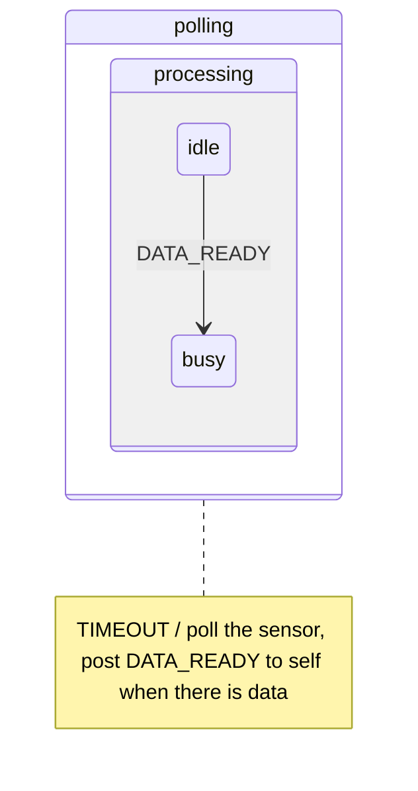

# 5. State patterns

Chapter 5 is a small catalogue of five *state patterns*, proven state machine designs for recurring problems. The first two are simple designs. The other three provide UML features that Samek's [event processor](glossary.md#event-processor) leaves out because they cost memory or time: event deferral, [orthogonal regions](glossary.md#orthogonal-region) and transitions to history. All five build on [behavioural inheritance](glossary.md#behavioural-inheritance) (see [State machines](03-state-machines.md)).

| Pattern | Intent in the book's words |
|---|---|
| [Ultimate Hook](glossary.md#ultimate-hook) (5.1) | ‘Provide common facilities and policies for handling events but let clients override and specialize every aspect of the system’s behavior.’ |
| [Reminder](glossary.md#reminder) (5.2) | ‘Make the statechart topology more flexible by inventing an event and posting it to self.’ |
| [Deferred Event](glossary.md#deferred-event) (5.3) | ‘Simplify state machines by modifying the sequencing of events.’ |
| [Orthogonal Component](glossary.md#orthogonal-component) (5.4) | ‘Use state machines as components.’ |
| Transition to History (5.5) | ‘Transition out of a [composite state](glossary.md#composite-state), but remember the most recent active [substate](glossary.md#substate) so you can return to that substate later.’ |

## Ultimate Hook

A system often needs one common policy for events, the look and feel of a user interface for example, while every client must be able to override any part of it (section 5.1). Nesting does exactly that. A [superstate](glossary.md#superstate) defines the default behaviour, and the client's [substates](glossary.md#substate) handle an event first. A substate overrides what it handles and inherits the rest by ignoring it.

The pattern also suggests a *canonical structure* for every state machine: one highest-level [composite state](glossary.md#composite-state) that contains everything else. The implicit [top state](glossary.md#top-state) cannot be changed, so this highest state is the place for policies that the whole machine inherits. Two idioms come with it:

- **Reset.** An empty transition from the highest state to itself exits every nested state, the highest one included, and then re-enters through the [initial transitions](glossary.md#initial-transition). [Exit actions](glossary.md#exit-action) clean up and [entry actions](glossary.md#entry-action) initialise, so this is the safest way to reset a machine.
- **Termination.** An explicit transition from the highest state to a state named *final*, whose entry action ends the machine, executes all the exit actions on the way out.

The consequences: a substate needs to know only the events it overrides, and new events can be added to the superstate without touching the substates. Changing or removing events that clients already use is hard, and passing every event through many levels of nesting costs time.

## Reminder

A periodic TIMEOUT drives the polling of a sensor, and the same event seems to have to drive both the polling and the processing of the data (section 5.2). Two [orthogonal regions](glossary.md#orthogonal-region) would separate them at the cost of slower dispatch and tricky synchronisation. The simpler solution is to invent an event, DATA_READY, and post it to the object itself as a [reminder](glossary.md#reminder) that data is ready. Nesting then arranges the two functions: a *processing* state inside a *polling* state inherits the polling, and its *busy* [substate](glossary.md#substate) can override TIMEOUT to suspend polling for a while.

Samek calls the Reminder ‘a “Swiss Army knife”’ for state machine topology (section 5.2.5). The pattern has more uses:

- It replaces *completion transitions*, which the processor does not support, by an explicit invented trigger. The designer then states the completion condition explicitly.
- It breaks a long RTC step into short ones. Each step posts a reminder for the next, and its parameters can carry the context, such as the index of the next iteration. More urgent events can then be handled between the steps.

A reminder posted FIFO lets other waiting events go first, which suits long work cut into steps. A reminder posted LIFO is guaranteed to be next, which suits a sequence that must not be interrupted. LIFO changes the order of events and must be used with care.

## Deferred Event

An event that arrives at an inconvenient moment, such as a new request while the previous one is being processed, is kept and handled later. A high-level state defers it, and the state that can handle it recalls it on entry. [Events and queues](02-events-and-queues.md) describes the mechanism and its LIFO recall.

## Orthogonal Component

An alarm clock does two largely independent things: it keeps time, in 12-hour or 24-hour mode, and it provides an alarm that is on or off (section 5.4). UML would model the two as [orthogonal regions](glossary.md#orthogonal-region). Samek's processor does not support regions, and regions are hard to reuse outside the machine they belong to. The pattern uses composition: the alarm becomes a component object with its own data and its own state machine, owned by the clock, the *container*.

- The container dispatches events to its components by calling their `dispatch()` directly, inside its own RTC step. The container can choose which events to pass on, and it can create new events on the fly.
- A component reports to its container by posting an event to the container's queue, never by dispatching to it, because the container is in the middle of its own RTC step whenever a component executes. These notification events are usually invented [reminders](glossary.md#reminder) and carry the component's ID when there are several components of one type.
- Container and components share one thread of execution, so they can share data without hazards. Shared data makes components less reusable.
- The container is responsible for its components: it must start their [initial transitions](glossary.md#initial-transition) and dispatch every relevant event to them, and a forgotten dispatch is a bug.
- Components can contain components of their own, to any depth, and the same component type can serve many containers.

The example also compares nested and flat mode switching (the *Device Mode* idiom). With high-level transitions from a [superstate](glossary.md#superstate) into each mode, a hierarchical machine needs a number of mode transitions proportional to the number of modes, *n*. A flat machine needs up to n × (n − 1) transitions between the modes.

## Transition to History

A toaster oven must switch the heater off and the lamp on whenever its door opens, and afterwards resume exactly what it was doing (section 5.5). UML handles this with *history* [pseudostates](glossary.md#pseudostate). Samek's processor offers no automatic history, which would cost memory for every state, and the pattern adds it where needed. The [exit action](glossary.md#exit-action) of the [composite state](glossary.md#composite-state) *doorClosed* stores the current state in a variable, and the transition back from *doorOpen* targets that variable.

- Each composite state with history needs its own history variable.
- *Deep* history is kept by setting the variable in the [entry action](glossary.md#entry-action) of every leaf [substate](glossary.md#substate).
- *Shallow* history is kept by setting the variable in the exit action of each direct substate.
- Resetting the variable clears the history.

## In the skill

`references/state-machines.md` lists these designs as common shapes: one outermost state for shared behaviour ([Ultimate Hook](glossary.md#ultimate-hook)), posting to oneself to split long work ([Reminder](glossary.md#reminder)), deferral and recall ([Deferred Event](glossary.md#deferred-event)), sub-machines owned by an object that report back by posting ([Orthogonal Component](glossary.md#orthogonal-component)), and a variable that remembers the last inner state (Transition to History).
