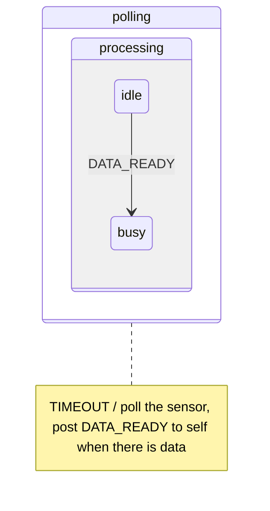

# 5. State patterns

A state pattern is a proven state machine design for a recurring problem.[^1] The five below all build on [behavioural inheritance](glossary.md#behavioural-inheritance) (see [State machines](03-state-machines.md)). Three of them provide UML features that the QEP processor leaves out to save memory and time: event deferral, [orthogonal regions](glossary.md#orthogonal-region) and transitions to history.

| Pattern | Intent |
|---|---|
| [Ultimate Hook](glossary.md#ultimate-hook) | Common handling for every event, which clients can override in every respect. |
| [Reminder](glossary.md#reminder) | An invented event, posted by an object to itself, that frees the shape of the state machine. |
| [Deferred Event](glossary.md#deferred-event) | A changed order of events that keeps the state machine simple. |
| [Orthogonal Component](glossary.md#orthogonal-component) | State machines used as components of an object. |
| Transition to History | A way out of a [composite state](glossary.md#composite-state) that remembers the last active [substate](glossary.md#substate) and can return to it. |

## Ultimate Hook

A system often needs one common policy for events, such as the look and feel of a user interface, while every client must be able to override any part of it. Nesting provides exactly that. A [superstate](glossary.md#superstate) defines the default behaviour, and the client's [substates](glossary.md#substate) see every event first. A substate overrides what it handles and inherits the rest by ignoring it.[^2]

The pattern suggests a *canonical structure* for every state machine: one highest-level [composite state](glossary.md#composite-state) that contains everything else. The implicit [top state](glossary.md#top-state) cannot be changed, so this highest state is the place for policies that the whole machine inherits. Two idioms come with it:

- **Reset.** An empty transition from the highest state to itself exits every nested state, the highest one included, and then re-enters through the [initial transitions](glossary.md#initial-transition). [Exit actions](glossary.md#exit-action) clean up and [entry actions](glossary.md#entry-action) initialise, which makes this the safest way to reset a machine.[^3]
- **Termination.** An explicit transition from the highest state to a state named *final*, whose entry action ends the machine, executes all the exit actions on the way out.

A substate needs to know only the events it overrides, and new events can be added to the superstate without touching the substates. Changing or removing events that clients already use is hard, and passing every event through many levels of nesting costs time.

## Reminder

A periodic TIMEOUT drives the polling of a sensor, and the same event seems to have to drive both the polling and the processing of the data. Two [orthogonal regions](glossary.md#orthogonal-region) would separate them at the cost of slower dispatch and tricky synchronisation. The simpler solution invents an event, DATA_READY, and posts it to the object itself as a [reminder](glossary.md#reminder) that data is ready. Nesting then arranges the two functions: a *processing* state inside a *polling* state inherits the polling, and its *busy* [substate](glossary.md#substate) can override TIMEOUT to suspend polling for a while.[^4]

The Reminder has further uses:

- It replaces *completion transitions*, which the QEP processor does not support, with an explicit invented trigger, so the completion condition is stated explicitly.
- It breaks a long RTC step into short ones. Each step posts a reminder for the next, and its parameters can carry the context, such as the index of the next iteration, so more urgent events can be handled between the steps.[^5]

A reminder posted FIFO lets other waiting events go first, which suits long work cut into steps. A reminder posted LIFO is guaranteed to be next, which suits a sequence that must not be interrupted, and changes the order of events.[^6]

## Deferred Event

An event that arrives at an inconvenient moment, such as a new request while the previous one is being processed, is kept and handled later. A high-level state defers it, and the state that can handle it recalls it on entry. [Events and queues](02-events-and-queues.md) describes the mechanism and its LIFO recall.

## Orthogonal Component

An alarm clock does two largely independent things: it keeps time, in 12-hour or 24-hour mode, and it provides an alarm that is on or off. UML would model the two as [orthogonal regions](glossary.md#orthogonal-region), but regions are expensive and hard to reuse outside the machine they belong to.[^7] Composition replaces them: the alarm becomes a component object with its own data and its own state machine, owned by the clock, its *container*.

- The container dispatches events to its components by calling their `dispatch()` directly, inside its own RTC step. The container chooses which events to pass on and can create new events on the fly.
- A component reports to its container by posting an event to the container's queue, never by dispatching to it, because the container is in the middle of its own RTC step whenever a component executes.[^8]
- Container and components share one thread of execution, so they can share data without hazards, and shared data makes components less reusable.
- The container is responsible for its components: it starts their [initial transitions](glossary.md#initial-transition) and dispatches every relevant event to them, and a forgotten dispatch is a bug. Components can contain components of their own, to any depth, and one component type can serve many containers.

Mode switching shows the difference between nested and flat machines. With high-level transitions from a [superstate](glossary.md#superstate) into each mode, the *Device Mode* idiom, a nested machine needs a number of mode transitions proportional to the number of modes, *n*, while a flat machine needs up to n × (n − 1).[^9]

## Transition to History

A toaster oven must switch the heater off and the lamp on whenever its door opens, and afterwards resume exactly what it was doing. UML handles this with *history* [pseudostates](glossary.md#pseudostate). QEP offers no automatic history, which would cost memory for every state, so the pattern adds it where needed.[^10] The [exit action](glossary.md#exit-action) of the [composite state](glossary.md#composite-state) *doorClosed* stores the current state in a variable, and the transition back from *doorOpen* targets that variable.

- Each composite state with history needs its own history variable.
- *Deep* history is kept by setting the variable in the [entry action](glossary.md#entry-action) of every leaf [substate](glossary.md#substate).
- *Shallow* history is kept by setting the variable in the exit action of each direct substate.
- Resetting the variable clears the history.

## In the skill

`references/state-machines.md` lists these designs as common shapes: one outermost state for shared behaviour ([Ultimate Hook](glossary.md#ultimate-hook)), posting to oneself to split long work ([Reminder](glossary.md#reminder)), deferral and recall ([Deferred Event](glossary.md#deferred-event)), sub-machines owned by an object that report back by posting ([Orthogonal Component](glossary.md#orthogonal-component)), and a variable that remembers the last inner state (Transition to History).

[^1]: Miro Samek, *Practical UML Statecharts in C/C++: Event-Driven Programming for Embedded Systems*, 2nd ed. (Newnes, 2009), ch. 5, p. 205.
[^2]: Ibid., §5.1.3, p. 206.
[^3]: Ibid., §5.1.3, p. 207.
[^4]: Ibid., §5.2.3, p. 212.
[^5]: Ibid., §5.2.5, p. 218.
[^6]: Ibid.
[^7]: Ibid., §5.4.2, p. 231.
[^8]: Ibid., §5.4.3, p. 233.
[^9]: Ibid., §5.4.3, p. 234.
[^10]: Ibid., §5.5.2, p. 245.
