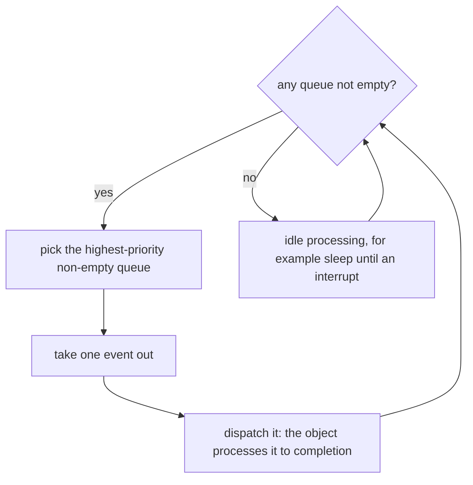

# 6. Kernels

[Active objects](glossary.md#active-object) need something that delivers their events and decides which object gets the CPU next. The book describes three kinds of kernel that can do it: a simple cooperative *vanilla* kernel, a preemptive *[run-to-completion](glossary.md#run-to-completion)* kernel called [QK](glossary.md#qk), and a traditional RTOS (sections 6.3.6 to 6.3.8, 7.11 and chapter 10). The application's objects stay the same on all three.

## Task-level response

Section 6.2.2 compares the two classic kernel types with a scenario. A low-priority task is running when an interrupt makes a high-priority task ready. The delay until the high-priority task actually starts is the *[task-level response](glossary.md#task-level-response)*.

- A **nonpreemptive** kernel gets control only when a task calls it. The high-priority task waits until the low-priority task blocks or yields, so the response depends on how the tasks cooperate. In return, tasks can safely use shared resources between two kernel calls.
- A **preemptive** kernel also gets control at the end of every interrupt. It switches straight to the high-priority task and resumes the low-priority one later. The response of the highest-priority tasks becomes deterministic, ‘But this determinism comes at a huge price of increased complexity in sharing resources.’ A switch can happen at almost any instruction, so shared data needs mutexes or similar mechanisms.

## The vanilla kernel

The *vanilla* kernel is cooperative and needs no threads (sections 6.3.7 and 7.11). One loop watches the queues of all [active objects](glossary.md#active-object), each queue having the priority of its object. ‘The scheduler always picks the highest-priority not-empty queue.’ It takes one event out of that queue, dispatches it to the object, which processes it to completion, and then starts the selection again. Interrupts can preempt a handler at any time, and they always return to the point where they interrupted it.

An interrupt that posts to a high-priority object while a low-priority handler runs has to wait for that handler to return. The [task-level response](glossary.md#task-level-response) of the [vanilla kernel](glossary.md#vanilla-kernel) is therefore the longest RTC step among all the objects (section 1.8.1). That is the same response as any nonpreemptive kernel, reached without per-task stacks or context switches. Event-driven handlers are short, because they never poll or block, and a long one can be cut into short steps with the [Reminder](glossary.md#reminder) pattern (see [State patterns](05-state-patterns.md)). Samek concludes: ‘I highly recommend the vanilla kernel as your first choice.’ Only an application whose timing it cannot meet needs a preemptive kernel.

### Going idle safely

When every queue is empty, the loop has reached the *[idle condition](glossary.md#idle-condition)*, and its idle processing is the natural place to put the CPU into a low-power sleep mode (section 6.3.7). Section 7.11 points out a race. If the loop enabled interrupts after finding all queues empty and before entering sleep, an interrupt in that gap could post an event, and the CPU would then sleep with an event waiting, until some later interrupt woke it. The kernel therefore calls its idle function with interrupts locked, and the idle function must unlock them ‘ideally atomically with the transition to a sleep mode’. Many microcontrollers allow that atomic transition, and others need a different technique.

## The preemptive run-to-completion kernel

When the [vanilla kernel](glossary.md#vanilla-kernel) is too slow for some deadline, Samek offers a preemptive kernel that suits [active objects](glossary.md#active-object) (sections 6.3.8 and 10.2). Its tasks are one-shot functions that [run to completion](glossary.md#run-to-completion), like interrupt service routines, and the kernel schedules them by priority the way a prioritised interrupt controller schedules interrupts. A task becomes ready in one of two ways:

- **[Synchronous preemption](glossary.md#synchronous-preemption).** A task posts an event to a higher-priority task. The kernel at once calls the higher-priority task as an ordinary C function, on top of the current one.
- **[Asynchronous preemption](glossary.md#asynchronous-preemption).** An interrupt posts an event to a task of higher priority than the interrupted one. At the end of the interrupt, the kernel calls the higher-priority task in place of returning to the interrupted one.

Every task finishes before the task below it continues, so all tasks share one stack, just as nested interrupts do. A task can never block, because the task beneath it on the stack could not resume. For active objects that is no limit, since they never block anyway.

One stack brings savings (section 10.2.5). Suspended tasks hold no private stack space, no task control blocks are needed, and the interrupt entry code that C compilers generate is good enough, because registers can be saved piece by piece. A footnote reports a GPS receiver in which such a kernel cut stack use by almost 80 percent compared with a traditional preemptive kernel.

Objects under a preemptive kernel can interrupt one another, so sharing becomes dangerous again. Samek repeats that active objects should share nothing. For a project that still shares a resource, [QK](glossary.md#qk) offers a *[priority-ceiling mutex](glossary.md#priority-ceiling-mutex)*, which blocks only the tasks up to a set priority and is immune to priority inversion (section 10.4.1).

## A traditional RTOS

The most common way to run [active objects](glossary.md#active-object) maps each one to a thread of an RTOS (section 6.3.6). The thread blocks on its empty queue and wakes when an event arrives. Under a preemptive RTOS, the system gets the same optimal [task-level response](glossary.md#task-level-response) as traditional tasks. [Run to completion](glossary.md#run-to-completion) still holds when a high-priority object preempts a low-priority one in the middle of an event: the low-priority object later resumes at the point of preemption and finishes that event before it takes the next.

## Choosing a kernel

Section 10.1 starts with the bad reasons for a preemptive kernel. [Active objects](glossary.md#active-object) already partition the problem, they do not need efficient blocking because they never block, their RTC steps are usually short, and the [vanilla kernel](glossary.md#vanilla-kernel) supports low-power modes. The good reason is time: a preemptive kernel runs high-priority work almost independently of low-priority work. A GPS receiver whose tracking loops must run while slow number crunching and display updates go on is Samek's example of an application that needs it.

The trade-off in one sentence: ‘The choice of a kernel type is really a tradeoff between the coupling in the time domain and sharing of resources.’ A nonpreemptive kernel allows sharing but couples the tasks in time. A preemptive kernel decouples them in time but does not forgive sharing.

| Kernel | Stacks | [Task-level response](glossary.md#task-level-response) | Sharing between objects |
|---|---|---|---|
| Vanilla (cooperative) | one | the longest RTC step of all objects | harmless between RTC steps, though the objects should still share nothing |
| [QK](glossary.md#qk) (preemptive, [run to completion](glossary.md#run-to-completion)) | one | deterministic for high priorities | dangerous, a [priority-ceiling mutex](glossary.md#priority-ceiling-mutex) if unavoidable |
| Traditional RTOS (preemptive) | one per thread | deterministic for high priorities | dangerous, as with any preemptive kernel |

## In the skill

Decision D1 chooses the kernel. `references/kernel.md` states what every kernel must do, whatever its kind, and spells out the vanilla loop with its safe idle. [A reference kernel](10-reference-kernel.md) shows one implementation in C and the details for FreeRTOS and Zephyr.
