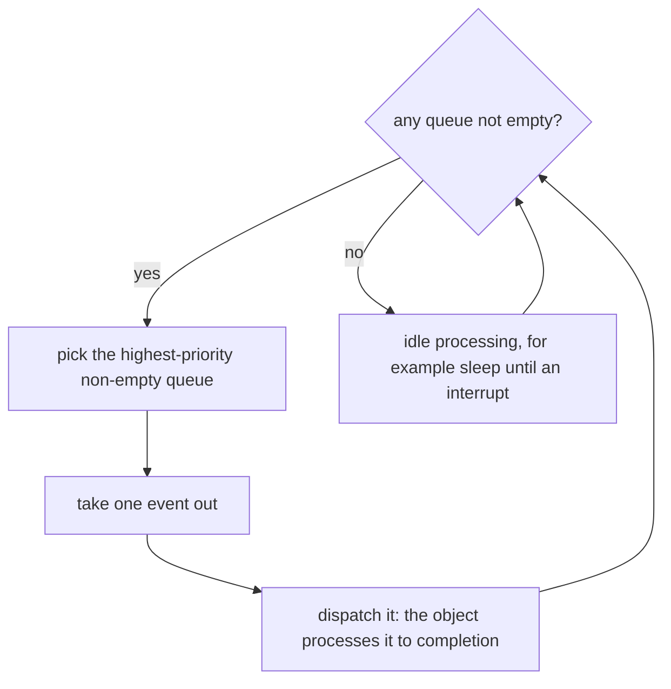

# 6. Kernels

[Active objects](glossary.md#active-object) need a kernel that delivers their events and decides which object gets the CPU next. Three kinds can do it: a simple cooperative *vanilla* kernel, a preemptive *[run-to-completion](glossary.md#run-to-completion)* kernel called [QK](glossary.md#qk), and a traditional RTOS. The application's objects stay the same on all three.

## Task-level response

The *[task-level response](glossary.md#task-level-response)* is the delay between an interrupt making a high-priority task ready to run and that task actually starting.[^1]

- A **nonpreemptive** kernel gets control only when a task calls it. The high-priority task waits until the running task blocks or yields, so the response depends on how the tasks cooperate. In return, tasks can safely use shared resources between two kernel calls.
- A **preemptive** kernel also gets control at the end of every interrupt, switches straight to the high-priority task and resumes the other one later. The response of the highest-priority tasks becomes deterministic, at the price of complexity in sharing resources: a switch can happen at almost any instruction, so shared data needs mutexes or similar mechanisms.[^2]

## The vanilla kernel

The *vanilla* kernel is cooperative and needs no threads. One loop watches the queues of all [active objects](glossary.md#active-object), each queue having the priority of its object, and always picks the highest-priority queue that is not empty.[^3] It takes one event out of that queue, dispatches it to the object, which processes it to completion, and then starts the selection again. Interrupts can preempt a handler at any time, and they always return to the point where they interrupted it.

An interrupt that posts to a high-priority object while a low-priority handler is busy has to wait for that handler to return, so the [task-level response](glossary.md#task-level-response) of the [vanilla kernel](glossary.md#vanilla-kernel) is the longest RTC step among all the objects.[^4] That is the response of any nonpreemptive kernel, reached without per-task stacks or context switches. Event-driven handlers are short, because they never poll or block, and a long one can be cut into short steps with the [Reminder](glossary.md#reminder) pattern (see [State patterns](05-state-patterns.md)). The vanilla kernel is therefore the first choice, and a preemptive kernel is needed only when its timing cannot be met.[^5]

### Going idle safely

When every queue is empty, the loop has reached the *[idle condition](glossary.md#idle-condition)*, and its idle processing is the natural place to put the CPU into a low-power sleep mode. Going idle hides a race. If the loop enabled interrupts after finding all queues empty and before entering sleep, an interrupt in that gap could post an event, and the CPU would then sleep with an event waiting until some later interrupt woke it. The kernel therefore calls its idle function with interrupts locked, and the idle function unlocks them, ideally atomically with the transition to sleep.[^6] Many microcontrollers allow that atomic transition, and others need a different technique.

## The preemptive run-to-completion kernel

A preemptive kernel that suits [active objects](glossary.md#active-object) treats its tasks as one-shot functions that [run to completion](glossary.md#run-to-completion), like interrupt service routines, and schedules them by priority the way a prioritised interrupt controller schedules interrupts.[^7] A task becomes ready in one of two ways:

- **[Synchronous preemption](glossary.md#synchronous-preemption).** A task posts an event to a higher-priority task, and the kernel at once calls the higher-priority task as an ordinary C function, on top of the current one.
- **[Asynchronous preemption](glossary.md#asynchronous-preemption).** An interrupt posts an event to a task of higher priority than the interrupted one, and at the end of the interrupt the kernel calls that task in place of returning to the interrupted one.

Every task finishes before the task below it continues, so all tasks share one stack, just as nested interrupts do.[^8] A task can never block, because the task beneath it on the stack could not resume. Active objects never block anyway, so the limit costs them nothing.

One stack saves memory. Suspended tasks hold no private stack space, no task control blocks are needed, and the interrupt entry code that C compilers generate is good enough, because registers can be saved piece by piece. In one GPS receiver, such a kernel cut stack use by almost 80 percent compared with a traditional preemptive kernel.[^9]

Under a preemptive kernel, objects can interrupt one another, so sharing becomes dangerous again, and active objects should share nothing. For a resource that must still be shared, [QK](glossary.md#qk) offers a *[priority-ceiling mutex](glossary.md#priority-ceiling-mutex)*, which blocks only the tasks up to a set priority and is immune to priority inversion.[^10]

## A traditional RTOS

[Active objects](glossary.md#active-object) most commonly run as threads of an RTOS. Each thread blocks on its empty queue and wakes when an event arrives, and under a preemptive RTOS the system gets the same optimal [task-level response](glossary.md#task-level-response) as traditional tasks. [Run to completion](glossary.md#run-to-completion) still holds when a high-priority object preempts a low-priority one in the middle of an event: the low-priority object later resumes at the point of preemption and finishes that event before it takes the next.[^11]

## Choosing a kernel

Several common reasons for a preemptive kernel do not apply to [active objects](glossary.md#active-object). The objects already partition the problem, they need no efficient blocking because they never block, their RTC steps are usually short, and the [vanilla kernel](glossary.md#vanilla-kernel) supports low-power modes. The real reason is time: a preemptive kernel lets high-priority work proceed almost independently of low-priority work, as in a GPS receiver whose tracking loops must keep pace while slow number crunching and display updates go on.

The choice is a trade-off between coupling in the time domain and sharing of resources. A nonpreemptive kernel allows sharing but couples the tasks in time, and a preemptive kernel decouples them in time but does not forgive sharing.[^12]

| Kernel | Stacks | [Task-level response](glossary.md#task-level-response) | Sharing between objects |
|---|---|---|---|
| Vanilla (cooperative) | one | the longest RTC step of all objects | harmless between RTC steps, though the objects should still share nothing |
| [QK](glossary.md#qk) (preemptive, [run to completion](glossary.md#run-to-completion)) | one | deterministic for high priorities | dangerous, a [priority-ceiling mutex](glossary.md#priority-ceiling-mutex) if unavoidable |
| Traditional RTOS (preemptive) | one per thread | deterministic for high priorities | dangerous, as with any preemptive kernel |

## In the skill

Decision D1 chooses the kernel. `references/kernel.md` states what every kernel must do, whatever its kind, and spells out the vanilla loop with its safe idle. [A reference kernel](10-reference-kernel.md) shows one implementation in C and the details for FreeRTOS and Zephyr.

[^1]: Miro Samek, *Practical UML Statecharts in C/C++: Event-Driven Programming for Embedded Systems*, 2nd ed. (Newnes, 2009), §6.2.2, p. 261.
[^2]: Ibid., §6.2.2, p. 262.
[^3]: Ibid., §6.3.7, p. 275.
[^4]: Ibid., §1.8.1, p. 49.
[^5]: Ibid., §6.3.7, p. 276.
[^6]: Ibid., §7.11.1, p. 383.
[^7]: Ibid., §6.3.8, p. 276.
[^8]: Ibid., §10.2.1, p. 486.
[^9]: Ibid., §10.2.5, p. 495.
[^10]: Ibid., §10.4.1, p. 515.
[^11]: Ibid., §6.3.6, p. 273.
[^12]: Ibid., §10.1, p. 485.
