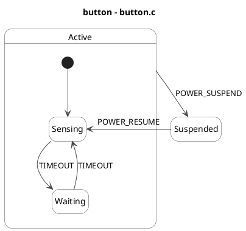
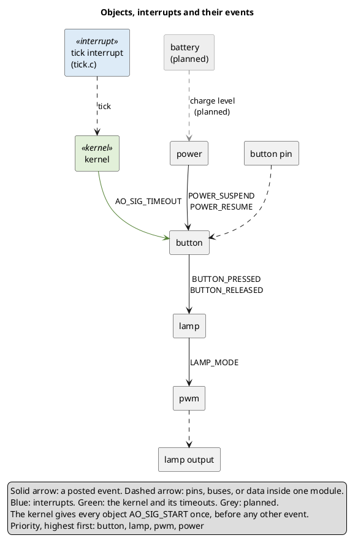

# Diagrams in UML and PlantUML

Each object's state machine is drawn as a UML statechart, and the objects together are drawn as one network diagram. A reader then sees what the software does without reading the handlers. The notation is UML's, and its words mean what `state-machines.md` defines. The diagrams are PlantUML text, so they live beside the code, change in the same commits and render to pictures. D16 decides where the files live and whether the project's documents also keep ASCII copies (`decisions.md`).

## Rules

- Draw one statechart for every object and one network diagram for the whole program. The network shows every object, the kernel, every interrupt, and every event posted between them.
- Draw the code as it behaves. Read the sources before drawing, and draw what they do, not what they should do: a diagram of the intended behaviour hides the deviations it exists to show. Planned links appear only on the network diagram, in grey and marked "(planned)".
- Change a diagram in the same change as the code it describes. A diagram that lags the code describes software that does not exist.
- Name objects, events and states as the code names them. A prefix that every state or event of an object carries, such as `BEAM_STATE_` or `_SIG`, may be dropped if the file's header comment says so.
- Where the code departs from UML semantics, say so in a note. For example, a handler that acts in an outer part before the state reacts reverses UML's order, in which the inner state reacts first.
- Keep every diagram as simple as it can be and still show its shape: a reader sees the states and transitions of a statechart, or the objects and events of the network, at a glance. What the code already says plainly stays in the code: no variable, action, counter, step number or note about a helper function. Draw a detail only when the shape cannot be understood without it, and then as one short phrase. A path that the code checks but can never take is left out.
- Render every diagram and look at the picture before handing it over. Fix syntax errors first, then any label that could belong to two arrows, then crossings.

Drawing is also a review. Report as a finding against `state-machines.md` every place where the picture cannot show the code plainly:

- a state whose transitions are decided inside helper functions;
- set-up repeated on several transitions into one state, which belongs in that state's entry action;
- independent parts packed into one variable, which are regions;
- a flag that acts as a state;
- behaviour repeated in every state, which belongs in an outer state.

## Files

- One `.puml` file per object, named after its source file (`button.puml`), and one `network.puml`.
- Each file starts with one comment line that says what it describes, that it shows the code as it behaves, and any prefix it drops. Its title names the object and its source file: `title button - button.c`.
- Labels use plain ASCII (`>=`, `<=`, `*`), which every PlantUML version and font renders.
- `plantuml -tpng -o <out dir> <file>.puml` renders a file. A syntax error gives an error picture and a nonzero exit status.

## Statecharts

A statechart shows the states of one machine and the transitions between them, nothing else.

| Element | PlantUML | Use it for |
|---|---|---|
| initial transition | `[*] --> Sensing` | the first state |
| transition | `Sensing --> Waiting : EVENT [guard]` | a change of state |
| self-transition | `Sensing --> Sensing : EVENT` | leaving the state and entering it again |
| outer state | `state Active { ... }`, then `Active --> Suspended : EVENT` | one arrow in place of the same arrow from every inner state |

Nothing else is drawn by default. Actions (posts, assignments, timer starts), entry and exit lines, internal transitions, choice nodes, variables and legends stay in the code and, for posts, in the network diagram. When the shape cannot be understood without one, write it as one short phrase after `/` on the arrow, such as `fades out`.

Conventions:

- A box holds its state name only.
- A label is `EVENT [guard]`. The guard is in domain words (`Off allowed`, `bright`), not a function call, and the guards on one event out of one state cover every case. A call whose result decides the next state is two arrows with opposite guards. `\n` breaks a long label.
- A state has no arrow for an event it ignores.
- One chart shows one machine. Independent parts of an object, and a sub-machine that the object calls within one handler call, each get their own chart, titled `object - part`. A sub-machine's triggers get lower-case names (`sample`, `press`), so that nobody mistakes them for queued events. Two parts of a few states each may share a chart as regions, separated by `--`.
- A chart that does not fit one screen is split, or its repeated arrows are folded into an outer state.
- The style is plain: `hide empty description`, `skinparam shadowing false`, white boxes with grey borders.

The statechart of the button in `state-machines.md`:

## The network diagram

| Element | PlantUML | Drawn as |
|---|---|---|
| object | `component button` | the default box |
| interrupt | `component "tick interrupt\n(tick.c)" as tick <<interrupt>>` | blue, `#DDEBF7` |
| kernel | `component kernel <<kernel>>` | green, `#E2F0D9` |
| pin, bus or sensor | `rectangle "button pin" as pin` | a plain box |
| posted event | `button --> lamp : BUTTON_PRESSED` | a solid arrow |
| timeout from the kernel | `kernel -[#548235]-> button : AO_SIG_TIMEOUT` | a green arrow |
| pins, buses, driver calls, data inside one module | `pwm ..> out` | a dashed arrow |
| planned link | `battery -[#888888,dashed]-> power : charge level\n(planned)` | a grey dashed arrow, from a grey box |

- `skinparam component` sets the two colours, as in the example below.
- Each pair of sender and receiver gets one arrow, labelled with every signal that travels it. A family of signals is written with `_*` and spelled out in the legend.
- The start event reaches every object, so it is one legend line, not an arrow per object.
- The legend explains the arrows and colours, names the families and gives the priority order.
- The layout runs top to bottom, from the inputs through the objects to the outputs. Packages, or `left to right direction`, are used only when the rendered picture reads better with them.

The network of the button example:

