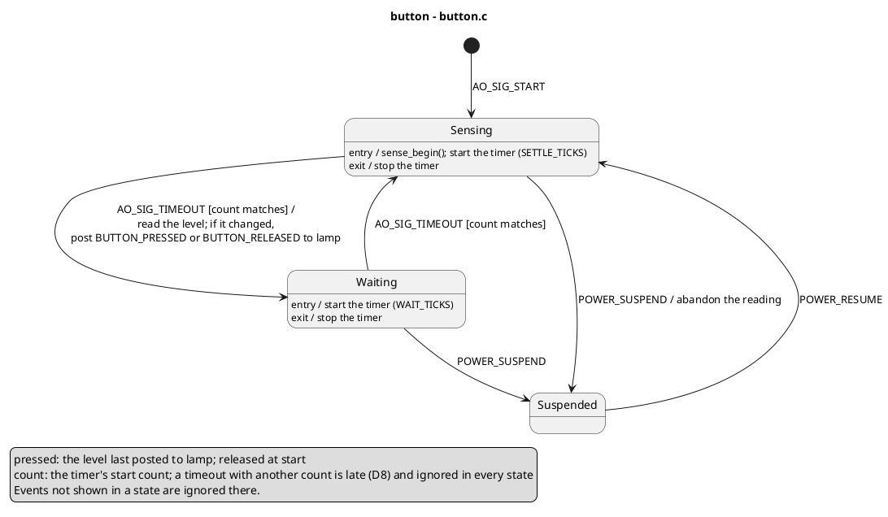
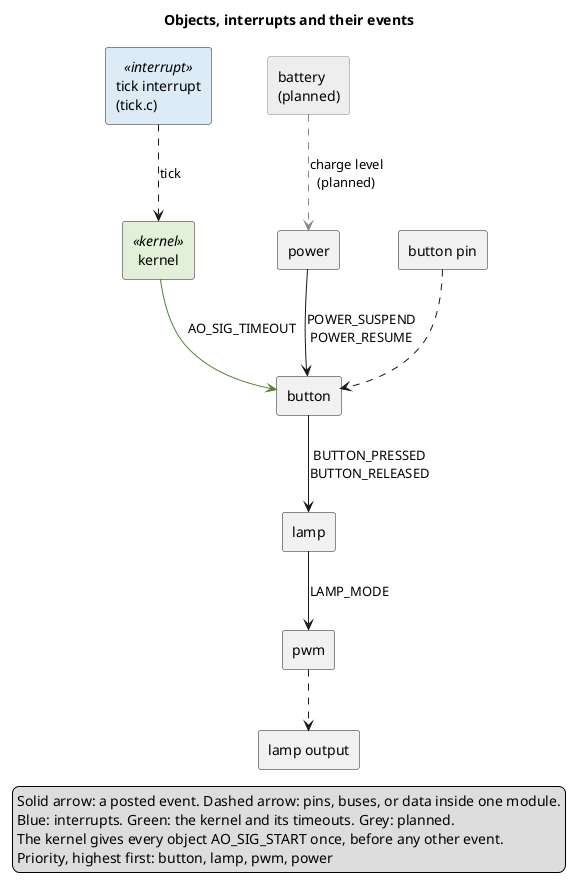

# Diagrams in UML and PlantUML

Each object's state machine is drawn as a UML statechart, and the objects
together are drawn as one network diagram. A reader then sees what the
software does without reading the handlers. The notation is UML's, and its
words mean what `state-machines.md` defines. The diagrams are PlantUML text,
so they live beside the code, change in the same commits and render to
pictures. D16 decides where the files live and whether the project's
documents also keep ASCII copies (`decisions.md`).

## Rules

- Draw one statechart for every object and one network diagram for the
  whole program. The network shows every object, the kernel, every
  interrupt, and every event posted between them.
- Draw the code as it behaves. Read the sources before drawing, and draw
  what they do, not what they should do: a diagram of the intended
  behaviour hides the deviations it exists to show. Planned links appear
  only on the network diagram, in grey and marked "(planned)".
- Change a diagram in the same change as the code it describes. A diagram
  that lags the code describes software that does not exist.
- Name objects, events, states and variables as the code names them. A
  prefix or suffix that every signal carries, such as `_SIG`, may be
  dropped if the file's header comment says so.
- Where the code departs from UML semantics, say so in a note. For example,
  a handler that acts in an outer part before the state reacts reverses
  UML's order, in which the inner state reacts first.
- Give each diagram the detail its reader needs and no more. Keep labels
  short and move definitions into the legend. A path that the code checks
  but can never take may be left out.
- Render every diagram and look at the picture before handing it over. Fix
  syntax errors first, then any label that could belong to two arrows, then
  crossings.

Drawing is also a review. Report as a finding against `state-machines.md`
every place where the picture cannot show the code plainly:

- a state whose transitions are decided inside helper functions;
- set-up repeated on several transitions into one state, which belongs in
  that state's entry action;
- independent parts packed into one variable, which are regions;
- a flag that acts as a state;
- behaviour repeated in every state, which belongs in an outer state.

## Files

- One `.puml` file per object, named after its source file (`button.puml`),
  and one `network.puml`.
- Each file starts with a comment that says what it describes, that it
  shows the code as it behaves, and any naming shortcut. Its title names
  the object and its source file: `title button - button.c`.
- Labels use plain ASCII (`>=`, `<=`, `*`), which every PlantUML version
  and font renders.
- `plantuml -tpng -o <out dir> <file>.puml` renders a file. A syntax error
  gives an error picture and a nonzero exit status.

## Statecharts

| Element | PlantUML | Use it for |
|---|---|---|
| initial transition | `[*] --> Sensing : AO_SIG_START / action` | the step taken on the start event |
| transition | `Sensing --> Waiting : EVENT(data) [guard] / action` | a change of state |
| internal transition | `Waiting : EVENT [guard] / action` | an action that stays in the state; it is written in the state's box |
| entry and exit actions | `Sensing : entry / action` and `Sensing : exit / action` | the state's own set-up and clean-up |
| self-transition | `Sensing --> Sensing : EVENT / action` | leaving the state and entering it again, so its exit and entry actions run |
| choice | `state ok <<choice>>`, then `Waiting --> ok : EVENT / r = read()` and `ok --> Reading : [r valid]` | a next state that depends on a value the action computes |
| outer state | `state Polling { ... }`, then `Polling : EVENT / action` | behaviour the inner states share |
| regions | `--` between the parts, inside a state named after the object | independent parts of one object, in place of every combination of their states |

Labels follow these conventions:

- A post is `post SIGNAL(data) to handle`, and a post to the object itself
  is `post SIGNAL to self`. An action used more than once gets a short name
  in the legend, such as `publish` or `fade in`.
- A guard reads the values before the action runs and has no side effects.
  Opposite guards cover every case. A call whose result decides the next
  state is an action followed by a choice, never a guard.
- A sub-machine that the object calls within one handler call is a region.
  Its triggers get lower-case names (`sample`, `press`), so that nobody
  mistakes them for queued events. The legend says which regions take
  queued events and in which order the handler calls the others.
- PlantUML drops leading spaces in a state's lines, so each line must read
  on its own. `\n` breaks a long transition label.
- The legend lists every kept variable with its meaning, unit and start
  value, every action name and every family of signals (`BUTTON_*`). It ends
  with "Events not shown in a state are ignored there." A state shows
  `/ ignore` only where a reader would expect it to handle the event.

Two independent parts, each with its own states:

```plantuml
state beam {
  state "beam" as Beam {
    [*] --> Off
    Off --> Low : SINGLE_PRESS / publish
  }
  --
  state "environment" as Environment {
    [*] --> Dark
    Dark --> Bright : AMBIENT_BRIGHT / publish
  }
}
```

The statechart of the button in `state-machines.md`, drawn from its event
table and code:



## The network diagram

| Element | PlantUML | Drawn as |
|---|---|---|
| object | `component button` | the default box |
| interrupt | `component "tick interrupt\n(tick.c)" as tick <<interrupt>>` | blue, `#DDEBF7` |
| kernel | `component kernel <<kernel>>` | green, `#E2F0D9` |
| pin, bus or sensor | `rectangle "button pin" as pin` | a plain box |
| posted event | `button --> lamp : BUTTON_PRESSED` | a solid arrow |
| timeout from the kernel | `kernel -[#548235]-> button : AO_SIG_TIMEOUT` | a green arrow |
| pins, buses, driver calls, data inside one module | `pwm ..> out` | a dashed arrow |
| planned link | `battery -[#888888,dashed]-> power : charge level\n(planned)` | a grey dashed arrow, from a grey box |

- `skinparam component` sets the two colours, as in the example below.
- Each pair of sender and receiver gets one arrow, labelled with every
  signal that travels it. A family of signals is written with `_*` and
  spelled out in the legend.
- The start event reaches every object, so it is one legend line, not an
  arrow per object.
- The legend explains the arrows and colours, names the families and gives
  the priority order.
- The layout runs top to bottom, from the inputs through the objects to the
  outputs. Packages, or `left to right direction`, are used only when the
  rendered picture reads better with them.

The network of the button example:


